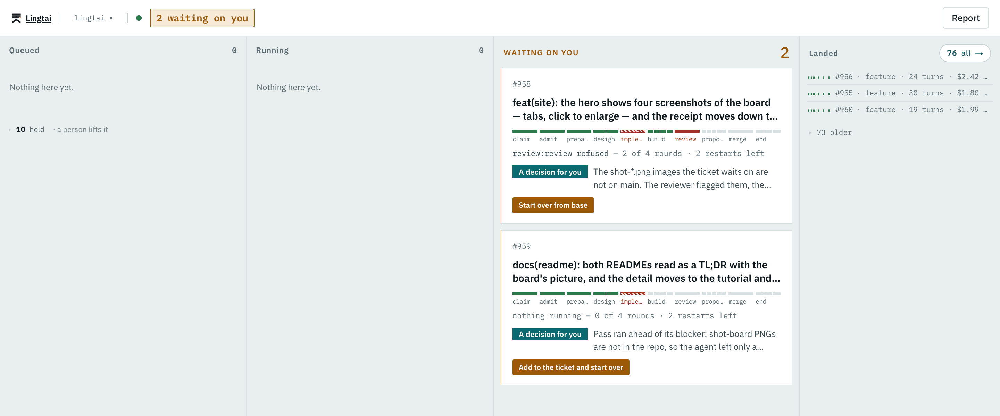

English · [中文](README.zh-CN.md)

<picture>
  <source media="(prefers-color-scheme: dark)" srcset="doc/logo-dark.png">
  
</picture>

# Lingtai

**Agents do the work. Lingtai keeps the books.**

Lingtai takes a queue of tickets, hands them to coding agents — several at
once, each in a worktree of its own — and holds each change at checks and a
cold review until it passes. It merges what passes, or stops for you. Every
step is written to a log on your machine as a result you can check: what the
agent was given, what it produced, what passed, who let it through, and what it
cost.

<a href="doc/img/shot-board-full.png"></a>
*The board — queued, running, waiting on you, landed*

## Install

You need Git and Claude Code or Codex, signed in, plus Node.js and npm for the example below. The rest is on [requirements](https://lingtai.hczhang.com/docs/requirements/).

```sh
curl -fsSL https://lingtai.hczhang.com/install.sh | sh
```

## Try it in five minutes

1. Clone the example, and make a bare repository beside it the checkout's `origin`, so Lingtai pushes and merges there and the original is never touched:

```sh
export CHAPTER_GARDEN_DIR="$HOME/workspace/chapter-garden"
mkdir -p "$(dirname "$CHAPTER_GARDEN_DIR")"
git clone https://github.com/steven-zhc/chapter-garden.git "$CHAPTER_GARDEN_DIR"
git clone --bare "$CHAPTER_GARDEN_DIR" "$CHAPTER_GARDEN_DIR.git"
git -C "$CHAPTER_GARDEN_DIR" remote set-url origin "$CHAPTER_GARDEN_DIR.git"
```

2. Register it, using a local SQLite log and holding for your approval before anything merges:

```sh
lingtai init --store sqlite --local "$CHAPTER_GARDEN_DIR" \
  --base main \
  --agent claude-code --reviewer claude-code \
  --install 'npm ci' --build 'npm run check' \
  --build 'npm run build' --defaults --land hold
```

3. Open a ticket. Your editor opens on a form: write the request there, and continue when Lingtai prints `created #N`.

   ```sh
   lingtai ticket new --project chapter-garden
   ```

4. Start Lingtai in one terminal and leave it running. In a second terminal, open the board:

   ```sh
   lingtai start
   lingtai board
   ```

5. When the ticket is waiting on you, read the change on the board and press **Approve**, or approve from a terminal; then pull to see the merged change:

   ```sh
   lingtai approve chapter-garden --issue <ticket-number>
   git -C "$CHAPTER_GARDEN_DIR" pull
   ```

Every option, Fish, a request to paste, and GitHub instead: [the tutorial](https://lingtai.hczhang.com/docs/tutorial/).

## Before you run it

- The agent runs on your machine, as you, in its own worktree; Lingtai's own credentials are not in its environment.
- Claude Code has no sandbox unless you turn one on: it can read any file you can, `~/.ssh` included. Codex runs sandboxed for writes.
- How to narrow it, per runtime: [safety](https://lingtai.hczhang.com/docs/safety/).
- Report a vulnerability: [SECURITY.md](SECURITY.md).

## Learn more

- [Concepts](https://lingtai.hczhang.com/docs/concepts/)
- [The tutorial](https://lingtai.hczhang.com/docs/tutorial/)
- [The guide](https://lingtai.hczhang.com/docs/guide/)
- [Why it is built this way](doc/why.md)

## License

[Apache License 2.0](LICENSE). See [`NOTICE`](NOTICE).
