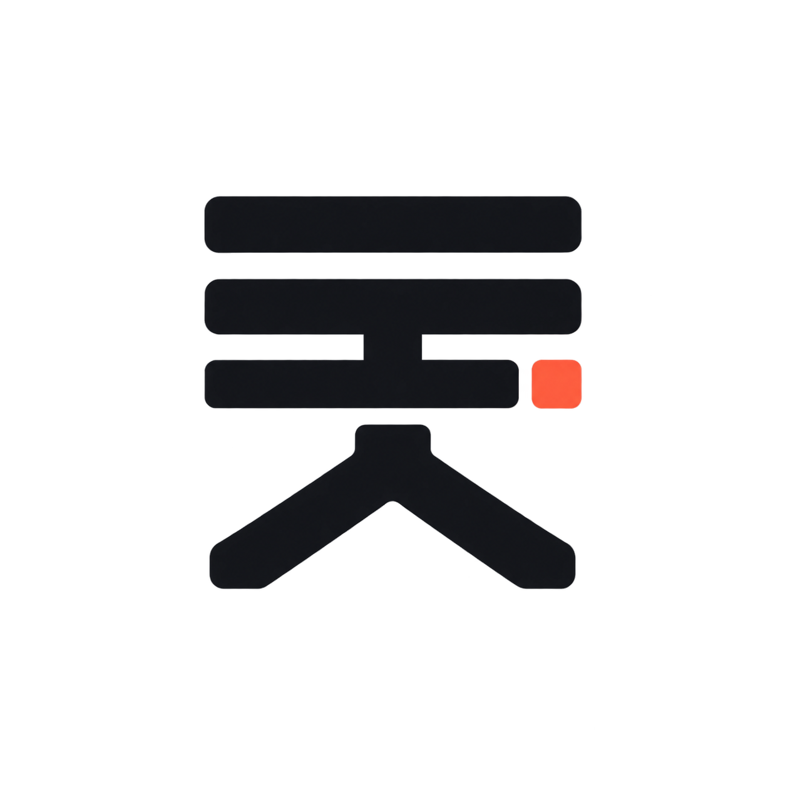

<picture>
  <source media="(prefers-color-scheme: dark)" srcset="doc/logo-dark.png">
  
</picture>

# Lingtai

Lingtai takes a queue of tickets, hands them to coding agents — several at
once, each in a worktree of its own — and holds each change at checks and a
cold review until it passes. It merges what passes, or stops for you, and every
decision is written to a log on your machine.

## Install

You need Git and Claude Code, signed in, plus Node.js and npm for the
example below; [requirements](doc/requirements.md) lists the rest.

```sh
curl -fsSL https://lingtai.hczhang.com/install.sh | sh
```

## Quickstart

This takes you from nothing to one ticket merged on this machine, with no
GitHub account. It uses [Chapter Garden](https://github.com/steven-zhc/chapter-garden),
a small Astro site. These are the POSIX shell commands; the
[tutorial](doc/tutorial.md) has Fish, and explains every option.

Clone it, and make a bare repository beside it the checkout's `origin`, so
Lingtai pushes and merges there and the original is never touched:

```sh
export CHAPTER_GARDEN_DIR="$HOME/workspace/chapter-garden"
mkdir -p "$(dirname "$CHAPTER_GARDEN_DIR")"
git clone https://github.com/steven-zhc/chapter-garden.git "$CHAPTER_GARDEN_DIR"
git clone --bare "$CHAPTER_GARDEN_DIR" "$CHAPTER_GARDEN_DIR.git"
git -C "$CHAPTER_GARDEN_DIR" remote set-url origin "$CHAPTER_GARDEN_DIR.git"
```

Register it with Lingtai, using a local SQLite log and holding for your
approval before anything merges:

```sh
lingtai init --store sqlite --local "$CHAPTER_GARDEN_DIR" \
  --base main \
  --agent claude-code --reviewer claude-code \
  --install 'npm ci' --build 'npm run check' \
  --build 'npm run build' --defaults --land hold
```

Open one ticket. Your editor opens; replace the form with a request such as
*Add the next chapter to* a story from the
[bookshelf](https://cg.hczhang.com/en/) (the tutorial has the full text),
including `labels: feature`. Continue when Lingtai prints `created #N`, which is
the number you approve below:

```sh
lingtai ticket new --project chapter-garden
```

Start Lingtai in one terminal and leave it running; it stays in the foreground.
In a second terminal, open the board:

```sh
lingtai start
lingtai board
```

When the ticket is waiting on you, read the change on the board and press
**Approve**, or do it from a terminal:

```sh
lingtai status chapter-garden --all
lingtai approve chapter-garden --issue <ticket-number>
```

Run `git pull` in your Chapter Garden checkout to see the merged change.

## What an agent can reach

An agent Lingtai dispatches runs on your machine, as your user. Here is what
that does and does not protect.

**Contained**

- The agent works in its own git worktree, not in your checkout.
- Its environment is filtered to `PATH`, `HOME`, `TMPDIR`, `LANG`, `USER` and
  `LOGNAME`, plus the variables your project declares. Lingtai's own
  `LINGTAI_*` credentials and database URL are not handed to it in its
  environment, though it can read the file they are kept in (see below).
- The recipe that sets its gates is not in the agent's worktree, so a change it
  commits cannot weaken its own checks.

**Not contained**

- The Claude Code runtime has no filesystem sandbox. That agent can read any
  file you can, including `~/.lingtai/config.yml` (the database URL and GitHub
  App settings) and `~/.ssh`, and it has network access.
- The Codex runtime does run in a sandbox (`--sandbox workspace-write`), which
  refuses writes outside its working directory, `$TMPDIR` and `/tmp`, and a few
  directories Lingtai adds for committing. A recipe with `tier: sandboxed` is served only by a
  runtime like that one, not by Claude Code. Do not assume the sandbox covers
  reads, or the network.

**What to do**

- Run Lingtai under a user or machine whose files you are willing to expose to
  the agent.
- To report a vulnerability, open an issue titled "security" with no details
  and we will reach you privately. See [SECURITY.md](SECURITY.md).

## Next

- [Why it is built this way](doc/why.md): the log, the goals, and the architecture.
- [The tutorial](doc/tutorial.md): the same path in full, with Fish, and Part 2, which moves the project to GitHub.
- [The ten steps of a pass](doc/the-pass.html): how one ticket gets built.
- [Architecture](doc/architecture.html): which process you are in, who appends to the log, and where state lives.
- [Operating](doc/operating.md): everything you type, and what every refusal means.
- [Reference](doc/reference.md): every term, the event types and the action kinds.
- [The decision log](doc/README.md) and the [roadmap](doc/roadmap.md).

## License

[Apache License 2.0](LICENSE). See [`NOTICE`](NOTICE).
