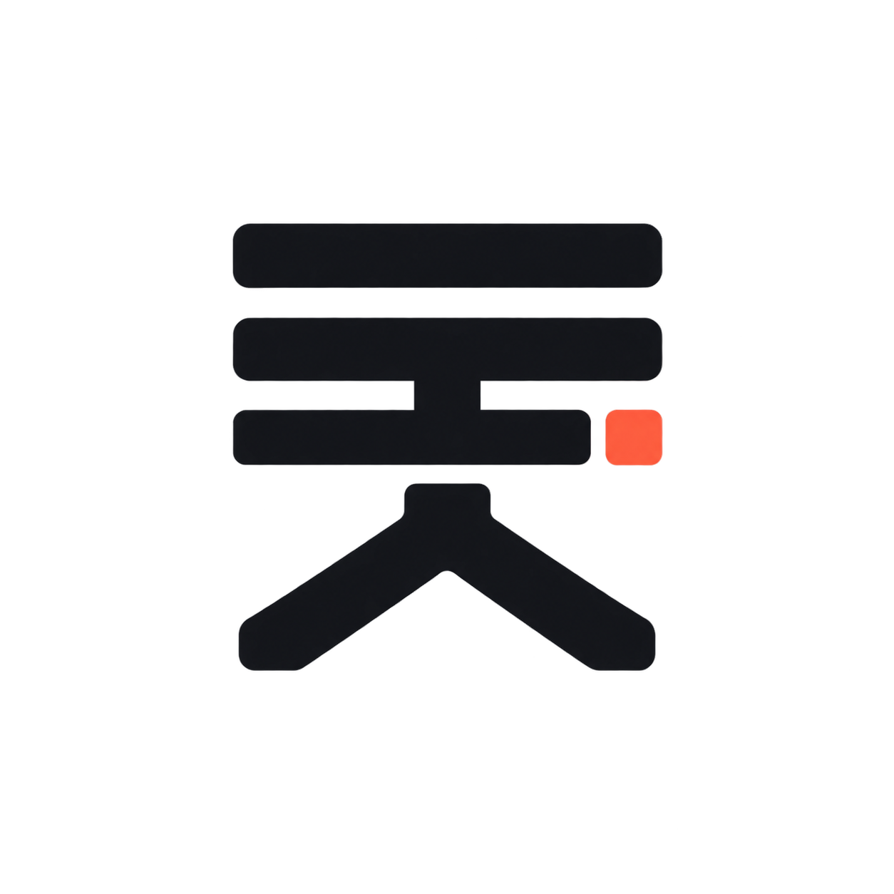
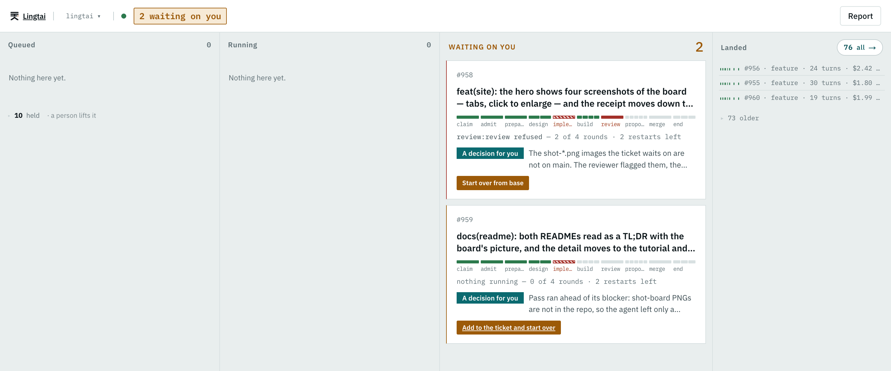
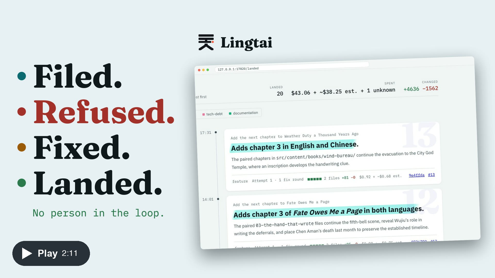

[English](README.md) · 中文

> 这是 [README.md](README.md) 的中文本。**英文本是正本**；两者不一致时以英文本为准。

<picture>
  <source media="(prefers-color-scheme: dark)" srcset="doc/logo-dark.png">
  
</picture>

# Lingtai

[](https://github.com/steven-zhc/lingtai/releases/latest)
[](https://github.com/steven-zhc/lingtai/actions/workflows/check.yml?query=branch%3Amain)
[](https://github.com/steven-zhc/lingtai/actions/workflows/integration.yml?query=branch%3Amain)
[](https://github.com/steven-zhc/lingtai/actions/workflows/release.yml?query=branch%3Amain)
[](https://github.com/steven-zhc/lingtai/actions/workflows/deploy-site.yml?query=branch%3Amain)
[](https://lingtai.hczhang.com/)
[](LICENSE)

**活儿给 agent 干，账由灵台记。**

Lingtai（灵台）接收一个由票组成的队列，把它们交给编码 agent——可以同时交给多个，每个都在各自的工作树里——并让每一处改动停在检查和冷审查处，直到通过为止。通过的改动它会合并，否则就停下来等你。每一步都作为一个可以核对的结果写进你本机上的日志：给了 agent 什么、它产出了什么、什么通过了、是谁放行的、花了多少钱。

<a href="doc/img/shot-board-full.png"></a>
*看板：排队、运行、等你处理、已落地*

<a href="https://www.youtube.com/watch?v=s27esf-NQlc"></a>
*视频，2:11：一张票从提交到落地（YouTube，带旁白和字幕）*

## Install

你需要 Git 和已登录的 Claude Code 或 Codex，下面的示例还需要 Node.js 和 npm；其余要求见 [requirements](https://lingtai.hczhang.com/docs/requirements/)。

```sh
curl -fsSL https://lingtai.hczhang.com/install.sh | sh
```

## Try it in five minutes

1. 先克隆它，再在旁边建一个裸仓库，作为这份检出的 `origin`，这样 Lingtai 会推送并合并到那里，原仓库不会被碰到：

```sh
export CHAPTER_GARDEN_DIR="$HOME/workspace/chapter-garden"
mkdir -p "$(dirname "$CHAPTER_GARDEN_DIR")"
git clone https://github.com/steven-zhc/chapter-garden.git "$CHAPTER_GARDEN_DIR"
git clone --bare "$CHAPTER_GARDEN_DIR" "$CHAPTER_GARDEN_DIR.git"
git -C "$CHAPTER_GARDEN_DIR" remote set-url origin "$CHAPTER_GARDEN_DIR.git"
```

2. 把它注册到 Lingtai，使用本地 SQLite 日志，并在任何合并之前等你批准（用 Codex 而不是 Claude Code 时，改为 `--agent codex --reviewer codex`）：

```sh
lingtai init --store sqlite --local "$CHAPTER_GARDEN_DIR" \
  --base main \
  --agent claude-code --reviewer claude-code \
  --install 'npm ci' --build 'npm run check' \
  --build 'npm run build' --defaults --land hold
```

3. 开一张票。编辑器会打开一份表单：在里面写下请求，等 Lingtai 打印出 `created #N` 再继续。

   ```sh
   lingtai ticket new --project chapter-garden
   ```

4. 在一个终端里启动 Lingtai 并让它一直运行；在第二个终端里打开看板：

   ```sh
   lingtai start
   lingtai board
   ```

5. 当这张票在等你时，在看板上阅读改动并按下 **Approve**，也可以在终端里批准；然后 pull 就能看到合并后的改动（新开的终端里没有 `CHAPTER_GARDEN_DIR`，路径用第 1 步设置的那个）：

   ```sh
   lingtai approve chapter-garden --issue <ticket-number>
   git -C "$HOME/workspace/chapter-garden" pull
   ```

全部选项、Fish、可直接粘贴的请求，以及改用 GitHub：见 [tutorial](https://lingtai.hczhang.com/docs/tutorial/)。

## Before you run it

- agent 在你的机器上以你的身份运行，在它自己的工作树里；Lingtai 自己的凭据不在它的环境里。
- Claude Code 除非你自己开启，否则没有沙箱：它可以读取任何你能读的文件，包括 `~/.ssh`。Codex 的写入在沙箱中运行。
- 如何按运行时收窄权限：见 [safety](https://lingtai.hczhang.com/docs/safety/)。
- 报告漏洞：见 [SECURITY.md](SECURITY.md)。

## Learn more

- [Concepts](https://lingtai.hczhang.com/docs/concepts/)
- [The tutorial](https://lingtai.hczhang.com/docs/tutorial/)
- [The guide](https://lingtai.hczhang.com/docs/guide/)
- [Why it is built this way](doc/why.md)

## License

[Apache License 2.0](LICENSE)。见 [`NOTICE`](NOTICE)。
