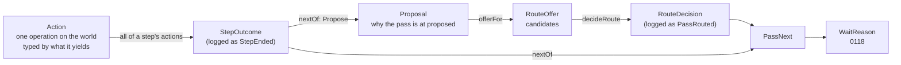

# 0120 — Reasons are types: a step ends as one event that carries its actions, `proposed` chooses among candidates it was offered, and every next move is one union decided by pure functions

**Status** accepted · 2026-10-12

Whenever Lingtai records or acts on a reason, that reason is a value of a
tagged union defined once in `@lingtai/domain`. It is never a string, never a
string to be parsed, never a combination of nullable fields, and never a
matter of whether some variable happened to be set. Each variant carries the
evidence that belongs to it.

A pass is a chain of such values. A step ends as one `StepEnded` that carries
every action the step declared. A step whose last action fell short either
sends the pass to `proposed` with a `Proposal`, or ends it. At `proposed` a
judge picks one candidate from an offer the workflow built, and the choice is
recorded with the offer and the reply. Whatever happens next is one
`PassNext`. Every decision between two of these values is a pure function;
the one effect in the middle, an agent judge's answer, sits between two of
them and is never hidden inside one.



The waiting half of the chain, `WaitReason`, `Resolution`, triage and the
functions over them, is [0118](0118-a-hold-explains-itself.md)'s. This ADR
owns everything before a wait and the principles both follow. The names here
are the glossary's words ([#450](https://github.com/steven-zhc/lingtai/issues/450)):
a union defined here is a term there, in the same spelling.

## Context

Every recent design question about waits has been a reason that existed only
as a combination of other fields:

- **Why a step was refused** is a string: the conductor's `StepRefused`
  carries `because: string` (`packages/conductor/src/pass.ts:291`).
- **Whether the router sent a pass on** was read from whether `stoppedAt` was
  set, so a build that stayed red was recorded as a failure and unsatisfied
  findings as a judgement, though the router sent both to a person
  (`8a669849`).
- **Why the pass reached the router** is `JudgeWhen`, a string enum, with
  `unreadable` as a separate flag (`packages/conductor/src/pass-steps.ts:885`)
  and the evidence travelling apart from both.
- **Where the router sent the pass** is `Destination`, defined three times
  (`packages/domain/src/events.ts:1330`, `packages/conductor/src/judge.ts:179`,
  `packages/conductor/src/pass.ts:434`).
- **How a fix round ended** is `FixApplied.headSha: string | null` with
  `failure: string | null`. A fixer that declined, one that crashed and one
  that hit a ceiling can only be told apart by combining the two, which is how
  a decline came to be filed as `DidNotFinish` (`d543eb05`).
- **An agent that ran and committed nothing** is `RunFailed{no-commits}` on a
  first dispatch and `FixApplied{headSha: null, failure: null}` in a fix
  round: one fact, two spellings.
- **A step's verdicts** are one event per action (`StepPassed`, `StepFailed`,
  `StepAsked`, `StepDidNotFinish`, `StepNeverRan`), so what the step as a
  whole amounted to is recomputed by every reader.

## Principles

1. **A reason is a type, not a string.** If code branches on a value, the
   value is a variant.
2. **The evidence travels with the variant.** `BuildRed` carries the red
   output, `MergeConflict` the conflicted paths. No field is "set only in
   some cases".
3. **Store facts, derive categories.** A category (_needs a decision_, _the
   machine broke_) is computed from facts by a function and never stored
   beside them.
4. **One name, one meaning.** A variant's name says which layer it belongs to
   and what it means. No bare `Held`, `Failure` or `Continue`.
5. **The page's word is the column id is the type name.** The board's lane is
   _Waiting on you_ and its id is `waiting`, so the types are `WaitReason` and
   `WaitOnPerson` and the event is `WaitStarted`. _Hold_ means only
   `agent:hold`. The step `proposed` is called `proposed`, never the router:
   what arrives there is a `Proposal`, what it does is route (a verb), and what
   it chooses is a `PassNext`, the same type every other step's next move is.
6. **Decisions are pure functions; effects are in the shell.** A pure function
   reads no store, clock, git or process. The shell calls it and acts on the
   answer.
7. **What excludes each other is a union; what can happen together is
   fields.** An agent can commit and ask a question in one run; making those
   two variants of one union loses one of them. Equally, orthogonal facts are
   never forced into exclusive variants to use a union.
8. **Plugins are open; what an action yields is closed.** Plugins will keep
   being added, and the types must not grow with them. The pass branches on a
   handful of things only: a verdict, a commit, a design, a question, a
   signoff, an integration. So an `Action` is typed by what it yields to its
   step, and the plugin is a string. A new plugin declares what it yields, and
   `nextOf`, `cleared` and `Proposal` do not change. A new yield is added only
   when a plugin produces something the pass must branch on and no yield
   covers, and then the pass's logic changes anyway. A plugin's own detail is
   its `evidence`, never a type; a plugin cannot add a `WaitReason`, and its
   failures land on the existing ones by yield and step.

## Decision

### 1. An action, and the step it ends

A step may declare several actions: `build` runs `pnpm test`,
`pnpm typecheck`, `pnpm lint`, each one an operation on the world. An
`Action` is one operation; a `StepOutcome` is a step ending, and it contains
all of that step's actions. The log has one event per step ending and none
per action.

```ts
type Assessment = { verdict: 'accepted' | 'refused'; findings: Finding[] }
type Design = { document: string; locator?: string } // both from the same action (action.ts:212); "" is "no design needed"
type Integration =
  | { _tag: 'Integrated'; mergeSha: string }
  | { _tag: 'Conflicted'; paths: string[] | null; baseSha: string | null; headSha: string | null } // null where the action's own result carried none (#466)
  | { _tag: 'IntegrationRefused'; reason: Exclude<RefusalReason, 'conflict'> }

type NeverStarted = { _tag: 'NeverStarted'; scope: 'conductor' | 'work-item' } // an account wall, an unmet environment
type NotReached = { _tag: 'NotReached' } // an earlier action fell short, so this one did not run
type Interrupted = { _tag: 'Interrupted'; cause: 'crash' | 'timeout' | 'aborted' | 'out-of-turns' | 'out-of-usd' } // agents only
type AnswerUnreadable = { _tag: 'AnswerUnreadable'; raw: string } // the agent answered and the machine could not read it
type NotDone = { _tag: 'NotDone' } // a mechanical operation did not happen: a file not kept, a tree not cut or not restored
type Waived = { _tag: 'Waived'; waitId: WaitId } // not run: a person approved past it in that wait (§6)

type ActionBase = {
  plugin: string // 'run', 'agent', 'watch', 'file', …: open (principle 8)
  name: string // as the recipe writes it
  onSha: string // where the branch stood when this action's turn came, run or not
  call: CallId | null // the paid call behind it, whose receipt #455 defines; null for commands, merges, signoffs
  evidence: string // what the plugin said, for a person; nothing branches on it; "" when not run
}

type Action = ActionBase &
  (
    | {
        yields: 'verdict'
        result:
          | { _tag: 'Completed'; assessment: Assessment }
          | AnswerUnreadable
          | Interrupted
          | NeverStarted
          | Waived
          | NotReached
      }
    | {
        yields: 'signoff'
        result: { _tag: 'Completed'; requested: { question: string } | null } | Waived | NotDone | NotReached
      } // null: not triggered; NotDone: the dependency a watch:/human: reads before it can ask threw (#466)
    | {
        yields: 'commit'
        result:
          | { _tag: 'Completed'; head: string | null; question: string | null } // head: where a commit left the branch; null: nothing committed
          | (Interrupted & { head: string | null }) // committed part of it, then stopped
          | NotDone // a kept-run could not restore the tree (kept-run-action.ts:80)
          | NeverStarted
          | NotReached
      }
    | {
        yields: 'design'
        result:
          | { _tag: 'Drafted'; design: Design; head?: string | null } // head: a file: destination's own commit; absent for the drafting agent, which never commits (#466)
          | { _tag: 'Asked'; question: string; draft: string | null }
          | AnswerUnreadable
          | Interrupted
          | NotDone
          | NeverStarted
          | NotReached
      }
    | { yields: 'worktree'; result: { _tag: 'Completed'; head: string } | NotDone | NotReached }
    | { yields: 'merge'; result: { _tag: 'Completed'; integration: Integration } | NotReached }
    | { yields: 'nothing'; result: { _tag: 'Completed' } | NotDone | NotReached } // did something; the pass asks only whether it did
  )

type StepOutcome = { step: Step; round: number; actions: Action[] } // every declared action, in order, the ones not run included
```

**Every plugin there is today yields one of the seven:**

| Yields     | Plugins                                                                                                        |
| ---------- | -------------------------------------------------------------------------------------------------------------- |
| `verdict`  | `run:` (except at `implement`), `agent:` at `review`, `proposed` and `merge` (a reviewer), `watch: then: fail` |
| `signoff`  | `human:`, `watch: then: request-approval`, the one `--no-merge` injects                                        |
| `commit`   | `agent:` at `implement`, `run:` at `implement` (a kept-run, which commits, `from-recipe.ts:275`)               |
| `design`   | `agent:` at `design`, `file:` at `design` (which keeps the design at a path and adds the locator)              |
| `worktree` | `worktree:` at `admit`                                                                                         |
| `merge`    | `merge:`, the lane                                                                                             |
| `nothing`  | `file-brief:` at `implement`                                                                                   |

One plugin may yield different things by configuration (`watch`'s `then`),
and what it yields is fixed when the recipe resolves. **The field is
`yields`, not role or kind**: _role_ is already an agent's role with its
permissions ([0053](../decisions-archive/0053-the-recipe-chooses-the-agent-for-each-role.md),
[0054](../decisions-archive/0054-a-role-keeps-its-permissions-when-its-agent-changes.md)),
and _kind_ is already the plugin's name (`ActionKind`, `recipe.ts`).

**Legality is two small tables.** Which yields a step accepts is the pass's
own and closed:

| Step      | Accepts                                                                       |
| --------- | ----------------------------------------------------------------------------- |
| admit     | `worktree`, `nothing`                                                         |
| prepared  | `verdict`, `nothing`                                                          |
| design    | `design`, `nothing`                                                           |
| implement | `commit`, `nothing`                                                           |
| build     | `verdict`                                                                     |
| review    | `verdict`                                                                     |
| proposed  | `verdict`, `signoff`                                                          |
| merge     | `verdict`, `signoff` (only the injected one, before the lane), `merge` (last) |

What each plugin yields at each step is declared on the plugin's own `at` in
`packages/recipe/src/recipe.ts`, and `conductor/unit/step-matrix.test.ts`
still walks every cell. `claim` and `end` are not in the table (§6), and a
`judge:` entry is not an action: it is asked only when `proposed` routes
(§3).

**Whether an action cleared is derived, never stored**, by yield alone:

| Yields                | Cleared when                                    |
| --------------------- | ----------------------------------------------- |
| `verdict`             | `Completed` with `accepted`, or `Waived`        |
| `signoff`             | `Completed` with `requested: null`, or `Waived` |
| `commit`              | `Completed` with `question: null`               |
| `design`              | `Drafted`                                       |
| `worktree`, `nothing` | `Completed`                                     |
| `merge`               | `Completed` with `Integrated`                   |

Not _passed_: a pass is already the noun for one ticket's way from claim to
end. `Waived` exists only on `verdict` and `signoff`, the two things a person
can approve past, and it replaces `StepWaived`.

**At most one action in a step fails to clear.** The pipeline stops at the
first one that does (`pass-steps.ts:719`) and the rest are `NotReached`, so
the deciding action is the last one not `NotReached`; if it cleared, the step
cleared, and a step with no actions cleared. Nothing stores a `decisive`
field.

**What carries forward is read from the actions.** The branch head is the
last `head` in the step (a `run:` written after the agent at `implement`
wins, as `pass.ts` has it today); the design is the step's last `Drafted` (a
`file:` after the agent wins, with its locator).

**_Changed nothing_ is a fact about the step.** An `implement` whose actions
all cleared and none of which carries a `head` changed nothing. Read off the
agent alone it would be wrong both ways: a kept-run after it may commit a
format, and a kept-run after a committing agent may have nothing to commit.

**`onSha` belongs to the action.** `implement` commits mid-step, so the sha
can move inside one step, and a force-push makes every earlier verdict stale
by arithmetic.

**A crash writes nothing to make up for it.** A conductor that dies inside a
step leaves no `StepEnded`; the next one resumes from the last `StepEnded`
and runs the interrupted step again. The verdicts of actions that had
finished are not on the log, and per-action events would lose the action that
was running all the same. Spend is unaffected: each paid call writes its own
receipt when it ends (#455).

**Spend has one source.** An `Action` carries no `usage` or `costUsd`, only
`call`, a reference to the receipt. `RunFinished`'s and the other events'
`costUsd` go with #455, or every dollar is counted twice.

### 2. `Proposal`: why the pass is at `proposed`

```ts
type Proposal =
  | { _tag: 'BuildRed'; output: string }
  | { _tag: 'ReviewFindings'; findings: Finding[] }
  | { _tag: 'ReviewEmpty'; said: string; findings: Finding[] } // refused, and no finding carries a failure scenario
  | { _tag: 'InputNeeded'; from: 'design' | 'implement'; question: string }
  | { _tag: 'MergeConflict'; output: string; paths: string[] | null; baseSha: string | null; headSha: string | null } // output is the lane's own text; the three path fields are null where the action's result carried none (#466)
  | { _tag: 'VerifyRed'; output: string } // the base moved, and the re-verify on it went red
  | { _tag: 'SetupRefused'; output: string } // prepared refused, or a non-verdict action did not finish
  | { _tag: 'CheckRefused'; output: string } // a declared check at proposed or before the lane at merge refused
  | { _tag: 'AnswerUnreadable'; raw: string } // the agent answered and the machine could not read it
  | { _tag: 'NothingProduced' } // implement at round 0 cleared and committed nothing
  | { _tag: 'FixerDisagrees'; said: string } // implement in a fix round cleared and committed nothing
  | { _tag: 'MergeRefused'; reason: RefusalReason; output: string } // the lane refused for one of the seven (§4)
  | { _tag: 'BudgetExhausted'; kind: 'out-of-turns' | 'out-of-usd'; turns: number | null; costUsd: number | null }
```

Each variant says which step it comes from; only `InputNeeded` can come from
two, so only it carries `from`, and `fromOf(proposal)` derives the step for
the rest. The five `JudgeWhen`s map onto it: `red` is `BuildRed`,
`verify-failed` `VerifyRed`, `conflict` `MergeConflict`, `needs-input`
`InputNeeded`, `findings` `ReviewFindings` and `ReviewEmpty`. Each of the
seven variants after `VerifyRed` has a `JudgeWhen` of its own, and its
built-in judge (`BUILT_IN_FOR`) is `null`: declared nothing, it reaches a
person, which is today's outcome with one `PassRouted` more.

There is no `proposalOf`: a proposal is `nextOf`'s `Propose` branch (§4),
read off the deciding action by step and yield, never by plugin:

| Step                            | Deciding action                                                   | Proposal                                                         |
| ------------------------------- | ----------------------------------------------------------------- | ---------------------------------------------------------------- |
| build                           | `verdict` `Completed{refused}`                                    | `BuildRed{output: evidence}`                                     |
| review                          | `verdict` `Completed{refused}`, a finding with a failure scenario | `ReviewFindings`                                                 |
| review                          | `verdict` `Completed{refused}`, none with one                     | `ReviewEmpty{said: evidence, findings}`                          |
| design                          | `design` `Asked`                                                  | `InputNeeded{question}` (the draft stays on the `StepEnded`)     |
| implement                       | `commit` `Completed` with a `question`                            | `InputNeeded{question}` (a commit beside it stays on the branch) |
| merge                           | `merge` `Completed{Conflicted}`                                   | `MergeConflict{output: evidence, ...Conflicted}`                 |
| merge                           | `merge` `Completed{IntegrationRefused{verify-failed}}`            | `VerifyRed{output: evidence}`                                    |
| merge                           | `merge` `Completed{IntegrationRefused}`, the other seven reasons  | `MergeRefused{reason, output: evidence}`                         |
| prepared                        | `verdict` `Completed{refused}` (a timeout is a refusal)           | `SetupRefused{output: evidence}`                                 |
| any                             | `nothing`, `worktree`, `commit`, `design`, `signoff` `NotDone`    | `SetupRefused{output: evidence}`                                 |
| proposed, merge                 | `verdict` `Completed{refused}`                                    | `CheckRefused{output: evidence}`                                 |
| review, proposed, merge; design | `AnswerUnreadable`                                                | `AnswerUnreadable{raw}`                                          |
| implement                       | round 0, all cleared, no `head`                                   | `NothingProduced`                                                |
| implement                       | round > 0, all cleared, no `head`                                 | `FixerDisagrees{said}`                                           |
| any                             | `Interrupted{out-of-turns \| out-of-usd}`                         | `BudgetExhausted{kind, turns, costUsd}`                          |

**Everything the work falls short on goes through `proposed`; only what has
nothing to decide, or nobody able to decide it, ends the pass without a
proposal (§4).** `proposed` is the one place a recipe author steps in, with
a `judge:` keyed by `when:` and a `human:` or `watch:` gate. A stop that
skipped it would silently disable those declarations for that stop, as an
unreadable review answer once skipped a declared `human:` (#467). Routing
what has only a person to offer costs nothing, because the built-in judge is
synchronous. And "only a person" is what nobody has declared yet, not what
nobody may ever declare: a judge for `MergeRefused{dirty-base}` can rebase
and retry, one for `SetupRefused` can restart, and one for
`BudgetExhausted` can restart from the kept work (#468), with the restart
counted in `restartsSpent` like any other.

- **`review` refuses.** Today `review` refuses nothing and its findings are
  judged on `proposed`'s way through (`pass-steps.ts:602`). A refusing
  reviewer now proposes `ReviewFindings` and the offer carries the restart, so
  the way-through judgement moves rather than being kept in two places.
- **An unreadable answer is a proposal.** It reached a person before any
  judge was asked (`pass-steps.ts:885`), so a `human:` declared at
  `proposed:` never saw it. It now proposes `AnswerUnreadable`, and with
  nothing declared a person still gets it.
- **`prepared`'s refusal and a check before the lane at `merge` route.** Both
  reach a person when nothing is declared, as they did before #467.

### 3. Route: how `proposed` chooses

```ts
type CandidateId = string // 'fix-lines', 'restart', 'hand-to-person', …

type CandidateNext =
  | Extract<PassNext, { _tag: 'FixRound' }>
  | { _tag: 'Requeued'; cause: Extract<RequeueCause, { _tag: 'Restart' }> }
  | { _tag: 'HandToPerson' } // a placeholder: the offer is built before there is a reason to hand over

type RouteCandidate = { id: CandidateId; next: CandidateNext } // next already carries the round or restart it spends
type ExcludedCandidate = {
  id: CandidateId
  because:
    | { _tag: 'CeilingReached'; ceiling: 'rounds' | 'restarts' } // pass.ts:973-974
    | { _tag: 'NoCriterion' } // nothing to hold an agent to (0038 §2)
}
type RouteOffer = { proposal: Proposal; available: RouteCandidate[]; unavailable: ExcludedCandidate[] }

type JudgeReply =
  { _tag: 'Selected'; candidate: CandidateId; why: string } | { _tag: 'Unreadable'; raw: string } | { _tag: 'NotAsked' } // no judge declared, or nothing but a person to choose

type RouteDecision =
  | { _tag: 'Selected'; candidate: CandidateId } // always an id in offer.available
  | {
      _tag: 'Escalated'
      because:
        | { _tag: 'NotAsked' }
        | { _tag: 'UnreadableReply'; raw: string }
        | { _tag: 'UnknownCandidate'; candidate: string }
        | { _tag: 'CandidateUnavailable'; excluded: ExcludedCandidate }
    }

const offerFor: (proposal: Proposal, policy: RoutingPolicy, spent: Spent) => RouteOffer
const decideRoute: (offer: RouteOffer, reply: JudgeReply) => RouteDecision
const routeNext: (
  offer: RouteOffer,
  reply: JudgeReply,
  decision: RouteDecision,
) => Extract<PassNext, { _tag: 'FixRound' | 'Requeued' | 'WaitOnPerson' }>
```

- **A judge picks an id from the offer**, never an arbitrary step. An answer
  outside the offer is `UnknownCandidate`; one the ceilings took out is
  `CandidateUnavailable`. That a `Selected` id is in `available` is data, so
  `decideRoute` guarantees it at run time and its exhaustive test pins it.
- **The candidates** (`onOffer`, `pass.ts:925`): that step again, for an
  `InputNeeded`; `implement`, from `implement` and every step after it,
  including a conflict or a red re-verify at `merge`, for the agent to fix on
  the new base; a restart from the base, for `ReviewFindings` only; a person,
  always.
- **No candidate sends `merge` back to `build`.** `onOffer` offers it today
  for "a conflict an agent resolved" (`pass.ts:930`), and nothing resolves
  conflicts: an unchanged branch goes green again and meets the same conflict.
  A conflict-resolving plugin can add it back (principle 8).
- **No criterion, no judge.** For `ReviewEmpty`; for a `ReviewFindings` where
  no finding carries a failure scenario; and for a `BuildRed` or `VerifyRed`
  with no output — every paid candidate is `unavailable` with `NoCriterion`.
  When only a person is left the shell asks no judge: reply and decision are
  both `NotAsked`. This is `judged`'s order today (`pass-steps.ts:837`):
  readable first, a criterion second, a judge last.
- **The budget is spent in `offerFor`.** An available candidate already
  carries `FixRound{to: 'implement', round: 3}`; `decideRoute` needs only the
  offer and the reply and never reinterprets a ceiling.
- **The decision stores no `next`.** A `Selected` that also stored `next`
  could pair `fix-lines` with `Landed`; `next` comes only from the stored
  offer, through `routeNext`.
- **`HandToPerson` never leaves the route.** `routeNext` replaces it with
  `WaitOnPerson{ProposedEscalated{proposal, because: JudgeHandedOver{why}}}`,
  and an `Escalated` with `ProposedEscalated{proposal, because}`. An
  `InputNeeded` with no judge becomes the more specific `AgentQuestion`.
- **Where a reply comes from.** A built-in (`BUILT_IN_FOR`, `judge.ts:466`)
  is a pure function; an agent judge is the effect; the shell synthesises
  `NotAsked`. A person is never a judge: a person is where `WaitOnPerson`
  goes.

### 4. `PassNext`: the next move, with what it spends

```ts
type PassNext =
  | { _tag: 'Advance'; to: Step } // along the spine, spending nothing, carrying no reason
  | { _tag: 'Propose'; proposal: Proposal } // to proposed, which routes
  | { _tag: 'FixRound'; to: 'design' | 'implement'; round: number } // back one step, spending this pass's round `round`
  | { _tag: 'Requeued'; cause: RequeueCause } // the claim released: terminal
  | { _tag: 'WaitOnPerson'; reason: WaitReason } // 0118: terminal
  | { _tag: 'Landed'; integrated: string } // terminal; the mergeSha of this pass's Integrated

type RequeueCause =
  | { _tag: 'Restart'; restart: number } // proposed chose to start over, spending the item's restart `restart`
  | { _tag: 'NeverStarted'; scope: 'conductor' | 'work-item' } // nothing to do with the diff; conductor scope also pauses

const nextOf: (
  outcome: StepOutcome,
  run: RunRef,
) => Extract<PassNext, { _tag: 'Advance' | 'Propose' | 'WaitOnPerson' | 'Requeued' | 'Landed' }>
const spentAfter: (spent: Spent, next: PassNext) => Spent
```

`nextOf` never returns `FixRound`: a step that falls short proposes, and only
a route spends. **What does not propose** is what has nothing to decide, or
nobody able to decide it, and `nextOf` answers it by yield and step:

| Yields / step | Fell short as                              | `nextOf`                        |
| ------------- | ------------------------------------------ | ------------------------------- |
| any           | `NeverStarted{scope}`                      | `Requeued{NeverStarted{scope}}` |
| any           | `Interrupted{crash \| timeout \| aborted}` | `WaitOnPerson{AgentCrashed}`    |
| `signoff`     | `Completed{requested}`                     | `WaitOnPerson{SignoffRequired}` |
| `merge`       | `Completed{Integrated}` (cleared)          | `Landed{integrated: mergeSha}`  |

An agent crash does not route because the judge would be an agent too, on
the same usage cap or login; retrying it is the scheduler's. A signoff is
`proposed`'s own gate. `Landed` and `Requeued` have nothing left to decide.

The seven lane refusals (§2's `MergeRefused`) are `dirty-base`, `unpushed-base`, `pending-migration`,
`no-commits`, `push-rejected`, `wip-commit` and `unexpected`
(`pass-steps.ts:606`): they stop the lane before the diff is in doubt.
`wip-commit` is the lane refusing a branch that carries a WIP commit
`conduct.ts`'s own `keepUncommittedWork` made for a stopped run (`#468`) —
never a judgement about the diff either, since the WIP is Lingtai's own
commit and not the agent's. `lane-busy` has not been written since #194
(`events.ts:140`) and leaves `RefusalReason` with the reset. A design step
cannot produce nothing: the drafter answers a document (`""` included), a
question, or something unreadable (`agent-action.ts:964-1031`).

- **Two ways to `proposed`.** Every pass whose review cleared passes through
  `proposed` with `Advance{to: 'proposed'}`, running what is declared there (a
  `human:` signoff). One whose step fell short arrives with
  `Propose{proposal}` and is routed, its reason in the value: going to route
  without saying why cannot be written.
- **A restart is a requeue.** It releases the claim and puts the item back in
  the queue, the same terminal a run that never started reaches (`outcomeOf`,
  `pass.ts:1245`), so it is `Requeued` with the restart in its cause.

**Invariants**, fixed by tests rather than types:

- `Advance.to` is later on the spine. Going back is only `FixRound`: `design`
  only for a question asked at `design`; `implement` for a question asked at
  `implement` and for every proposal from a step after it.
- `Landed` comes only from a `merge` action's `Integrated`, never from
  everything before it having cleared.
- A terminal (`Requeued`, `WaitOnPerson`, `Landed`) ends this call of
  `runPass`: `end` runs after it and no step starts. A `WaitOnPerson` resolved
  by `Approve` continues the same run in a new call (§6).
- `round` and `restart` are what was spent plus one, computed by `offerFor`,
  written into the candidate, and applied by `spentAfter` without a second
  judgement.
- **Rounds count per pass, restarts per item** (`onOffer`'s _claim spends the
  item's restart and each of the others spends one of this pass's rounds_).
  A pass after a restart starts at round 0.

### 5. Events

Only what the log cannot compute is recorded. What a pure function derives
from recorded events is not stored again (principle 3); what depends on the
world (a command, an agent, a judge, a person) is.

```ts
StepStarted { runId, step, round } // one per step, no longer one per action
StepEnded { runId, outcome: StepOutcome }
PassRouted { runId, offer: RouteOffer, reply: JudgeReply, decision: RouteDecision }
```

- `PassRouted` stores the offer, because it depends on the recipe and the
  spend at that moment, and the reply, because it depends on the judge.
  `next` is not stored: replay computes `routeNext(offer, reply, decision)`.
  The offer's `proposal` could be computed from the `StepEnded` before it; it
  is kept on purpose, so the event reads on its own.
- **What is not recorded.** `Advance` is told by the next `StepStarted`. The
  other results of `nextOf` land through the events that already carry them:
  `WaitStarted` (0118), `WorkItemReleased`, `WorkItemLanded`. Rounds spent are
  folded from the run's `PassRouted`; restarts spent from the work item's
  `WorkItemReleased{cause: Restart}`, so neither fold reads another stream.
- **`WorkItemReleased` carries a `cause`**: `Restart{restart}`,
  `NeverStarted{scope}`, `ByPerson{waitId}` or `ClaimUnconfirmed`. Restarts
  are counted on the work item today (`conduct.ts:946`, from `PassRestarted`,
  `work-item.ts:282`), and `PassRestarted` becomes part of `PassRouted` on the
  run stream, so the release says why on the work item. Only `Restart` counts;
  a person's requeue does not, as today.
- **The merged sha is in three places**: `StepEnded`'s `Integrated`,
  `IntegrationSucceeded` on the integration stream, `WorkItemLanded` on the
  work item. Each stream's fold needs its own, the same code writes all three,
  and they are not one append, so where they disagree `StepEnded` is right.

What every existing event becomes is the appendix.

### 6. The seam

```ts
const runPass: (command: {
  run: RunRef
  item: ClaimedItemRef
  recipe: ResolvedRecipe
  from?: { step: 'admit' } | { step: 'proposed' | 'merge'; approved: WaitId }
}) => Effect<PassEnd>
type PassEnd = Extract<PassNext, { _tag: 'Requeued' | 'WaitOnPerson' | 'Landed' }>
```

- **When `runPass` returns, the terminal is on the log.** Callers no longer
  call `offerFor`, `decideRoute`, `nextOf` or `spentAfter`, nor translate the
  result through `outcomeOf`; `PassResult.stoppedAt`, `rested` and
  `outcomeOf` become one `PassEnd`. The functions are `runPass`'s own and are
  unit-tested directly; their types are here because what they produce is
  logged.
- **`claim` happens before `runPass`.** Its three declines (`passed-over`,
  `not-claimed`, `claim-unconfirmed`) are none of the three terminals, and
  `conduct.ts:3249` special-cases them today. The conductor claims first and
  calls `runPass` only with an item; the `queue:` plugin stays, outside
  `StepOutcome`.
- **`end` runs after the terminal and writes no `StepEnded`.** It is not a
  list of actions (`from-recipe.ts:406`); its fact is `EndActionsResolved`,
  whose `outcome` derives from the `PassEnd`: `Landed` is landed, `Requeued`
  failed, `WaitOnPerson` blocked. A wait resolved by `Close` is closed, and
  `close.ts` resolves `end` for it.
- **An approval continues the run** at the step its wait arose at, with the
  approved action `Waived` (0118 §11). The continuation uses the current
  recipe (0047 §1), finds the approved action by step and name, and does not
  re-inject `--no-merge`, which belonged to the call that was asked.
- **`resolveWait` is 0118's**, and a query is not a seam: the board and the
  CLI read the projection.

## Two phases

**Phase 1: the types and the pure functions, with no log change.** Each union
and its function land with an exhaustive test, a small ticket each, chained
with GitHub's _blocked by_: `Action` and `StepOutcome` with `cleared`;
`Proposal` and `nextOf`; `RouteOffer`, `offerFor`, `decideRoute` and
`routeNext`; `PassNext` and `spentAfter`; 0118's `WaitReason` and
`allowedResolutions`. The pass calls them in place of its own branches. Where
it writes an event, a temporary **event-boundary adapter** turns the new
value into today's payload; the adapters are the only place both shapes
exist, each says so in its comment, and no reader is written against the new
shape until phase 2.

**Phase 2: one ticket switches the events and resets the log.** It applies
the appendix, deletes the adapters and resets the log, with the old-log guard
(#451) and the reset steps (#448). Before 1.0 a stored shape changes by a
reset, not an upcaster. It starts only when phase 1 is complete, and the
renames #450 owns that touch the log (`WorkItemBlocked`, `HoldTriaged`) go in
the same reset, never alone.

## Consequences

- **The pass's branching moves into these functions.** `pass.ts` and
  `conduct.ts` keep the loop and the effects.
- **`review` refuses, and `proposed`'s way through judges nothing.** The
  restart is offered for `ReviewFindings` at the route.
- **An approval runs `merge`'s declared checks.** `approve.ts` integrates
  directly today and skips them.
- **The board loses which action of a step is running.** `StepRequested`
  goes; a running step's current action is in the run log (`lingtai attach`).
- **What stays a string** is text a person or an agent wrote and nothing
  branches on: a question's wording, a `why`, an `evidence`, raw output. If
  something branches on a string, that string is a missing variant.

## Not decided here

- **Who calls the continuing `runPass` after an approval**: the CLI, taking
  the lock, or the daemon. It is decided with the ticket that builds it.

## Not built yet

All of it. 0118's waits are built against today's `Hold`, which #450 renames.

---

## Appendix: event migration

What each event becomes in phase 2.

| Today                                                                                                              | Becomes                                                         | Why                                                                                                                                                                                                                                                       |
| ------------------------------------------------------------------------------------------------------------------ | --------------------------------------------------------------- | --------------------------------------------------------------------------------------------------------------------------------------------------------------------------------------------------------------------------------------------------------- |
| `StepPassed`, `StepFailed`, `StepAsked`, `StepDidNotFinish`, `StepNeverRan`, `FixApplied`, `RunFailed{no-commits}` | `StepEnded`                                                     | §1; a fix round is `implement` again with `round` > 0                                                                                                                                                                                                     |
| `StepStarted` (one per action, `events.ts:736`)                                                                    | `StepStarted`, one per step                                     | the same grain as `StepEnded`                                                                                                                                                                                                                             |
| `StepRequested`                                                                                                    | removed                                                         | per action, before it runs (`action.ts:615`); the run log carries it                                                                                                                                                                                      |
| `FixRequested`, `PassRestarted`, `FixDeclined`                                                                     | `PassRouted`; a restart also `WorkItemReleased{cause: Restart}` | the selected candidate's `next` is `FixRound` or `Requeued{Restart}`; a decline is `Escalated{CandidateUnavailable}`. What `PassRestarted` carried (branch, head, findings) is on the previous run, which the next prompt reads (`lastRun`, `conduct.ts`) |
| `WorkItemBlocked{hold}`                                                                                            | `WaitStarted` (0118)                                            | _blocked by_ is GitHub's word for a dependency                                                                                                                                                                                                            |
| `WorkItemUnblocked{by, note, withdrawn}`                                                                           | `WaitResolved` (0118)                                           | one event carrying a `Resolution`; `withdrawn` is an `OwnQuestion` resolved by `Requeue`                                                                                                                                                                  |
| `ApprovalRequested`                                                                                                | removed                                                         | a `signoff` with `requested` on `StepEnded`, then `WaitStarted{SignoffRequired}`                                                                                                                                                                          |
| `ApprovalGranted`                                                                                                  | removed                                                         | `WaitResolved{Approve}`                                                                                                                                                                                                                                   |
| `ApprovalRevoked`                                                                                                  | removed                                                         | nothing has written it since #150 removed Reject                                                                                                                                                                                                          |
| `StepWaived`                                                                                                       | `Waived{waitId}` on the waived action                           | approval waivers live on the action; the standalone `waive()` (`approve.ts:584`) has no caller                                                                                                                                                            |
| `RepairRequested`, `RepairDeclined`, `RunRef.repairOf`                                                             | removed                                                         | the repair purchase retired with #143 (`retiredRepairPending`, `conduct.ts:907`)                                                                                                                                                                          |
| `HoldTriaged`                                                                                                      | `WaitTriaged` (0118)                                            | principle 5                                                                                                                                                                                                                                               |
| `WorkItemReleased{runId, reason}`                                                                                  | adds `cause`                                                    | §5                                                                                                                                                                                                                                                        |
| `IntegrationRefused{paths?, baseSha?, headSha?}`                                                                   | without the three conflict fields                               | only `hold-of.ts:188` reads them, and they are on `StepEnded`'s `Conflicted`; the lane's serialising (`laneIsBusy`), the daemon's wake (`work-loop.ts:98`) and the board (`task-view.ts:715`) read the rest                                               |
| `RunFinished.costUsd` and the other cost fields                                                                    | #455's receipts                                                 | one source of spend                                                                                                                                                                                                                                       |

**Unchanged**: `RunAwaitingInput` (a runtime's own notification, written by
the hook, `hook-socket.ts:249`, and read by nothing that decides),
`WorkItemLanded`, `IntegrationAttempted`, `IntegrationSucceeded`,
`StepsResolved`, `EndActionsResolved`, `DispatchRefused` (before `runPass`),
and the rest of `EVENTS`.

---

_New topic; replaces no archived ADR. The type design was worked out in
`doc/design/types.zh.md`, which this ADR replaces._
