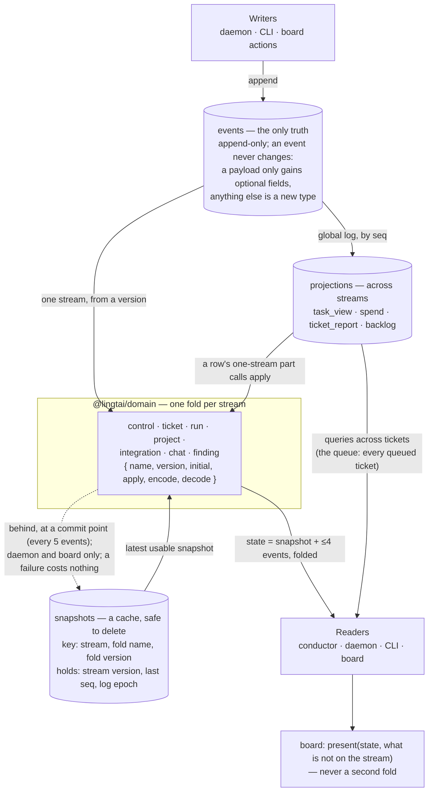
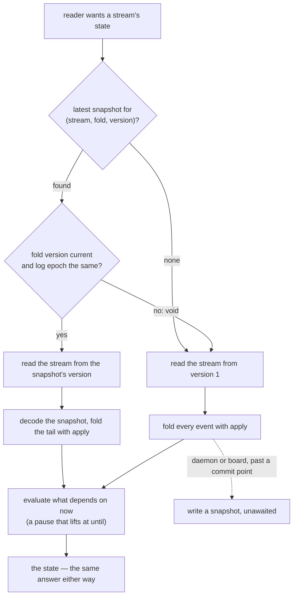
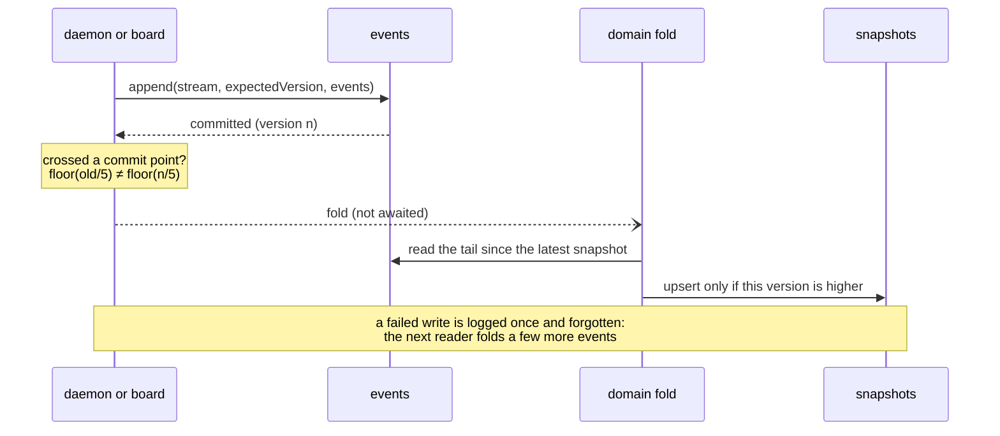
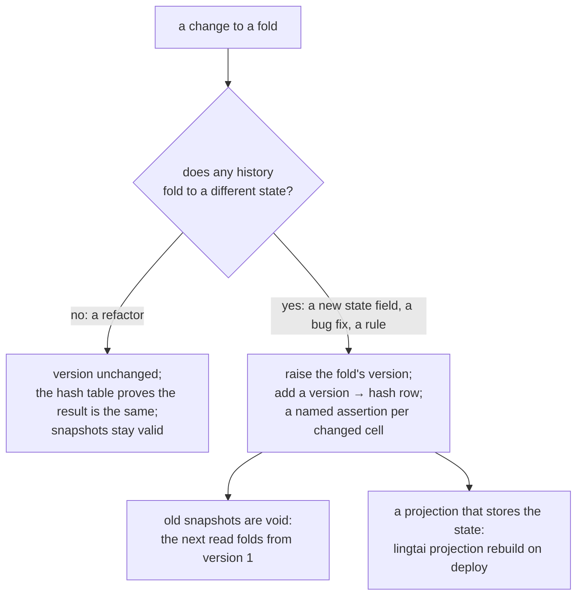

# One fold per stream, in `@lingtai/domain`: map and path

This is the plan for [0101](../decisions/0101-typescript-packages-effect-unbuilt.md) §4,
*a stream's fold exists once, here*, and for
[0124](../decisions/0124-a-stream-fold-is-cached-as-a-snapshot.md), which says the same
thing: *"the fold exists once, in `@lingtai/domain`"*, and *"where a projection folds
one stream's part of a row, it calls the same domain `apply`"*.

The survey is read-only. It was made on 2026-10-31 at `690dbbbb` and re-checked at
`4fa71683`, which is after #796 landed. #796 added one line near the top of
`apps/board/src/lib/task.ts` and so moved every later line in that file by one. For
that file this document therefore names **functions** (`foldRun`, `claimsOf`,
`standingOf`, `ticketFieldsOf`, `foldChat`, `outcomeOf`). Every other line number is
as of `4fa71683`. A ticket cut from this plan re-checks every line it cites against
the code as it is on that day.

**#796 has landed** (`d3ebd1a7`). It added `CONTROL_FOLD_TYPES`
(`packages/domain/src/control.ts:31`), the event types `reduceControl` reads, and
`EventStore.readTypes` (`packages/event-store/src/event-store.ts:359`), so a reader
that only folds asks the store for just those types. Any control-fold change here
(R7, R8) keeps that list in step with what `applyControl` reads.
`unit/control.test.ts` fails on a type that is folded but not listed.

## Where this ends: the architecture

What the system looks like when the epic (#797) and 0124's snapshots have landed. The
decisions are [0100](../decisions/0100-one-append-only-log.md) §1–§4,
[0101](../decisions/0101-typescript-packages-effect-unbuilt.md) §4 and §6, and
[0124](../decisions/0124-a-stream-fold-is-cached-as-a-snapshot.md).

### Reading a stream's state

### Writing, and a snapshot behind it

### When a fold changes

The state is always what the current fold makes of the whole stream. It never
depends on when a snapshot happened to be written.

### Where the code runs

Backend code that does IO is an Effect (0101 §6); `Effect.runPromise` runs only at a
host's edge. An Effect span is an OpenTelemetry span, so a pass is one trace (#791).
The fold itself is pure and stays in `domain`, outside Effect. Order: #797 (this
plan, with 0124's snapshots last), then #790's projector, `pass.ts` and daemon rows.

## 0. The count

Pattern: `case '<T>'`, `.type === '<T>'`, `type === '<T>'`, with `<T>` one of the 66
names in `doc/events.json`. Only `src/` files are counted. `packages/domain/src` is
excluded, and so is `apps/board/.next/`, a build copy that would double every board
count.

**138 branches in 34 files.** A second pass for `.type !== '<T>'` finds 13 more that the
first pattern misses. They are listed in §1.9 and are not part of the 138.

| Class | Branches | Where |
|---|---:|---|
| **F**: a stream fold that duplicates a domain reducer | **48** | run 26, ticket 14, control 4, chat 4 (chat has no domain reducer) |
| **P**: a projection fold | **46** | task-view 20, ticket-report 16, spend 6, backlog 4 |
| **R**: a reaction, trigger or renderer | **17** | tell 7, extension 5, work-loop 3, markdown 1, conduct 1 |
| **S**: a select or lookup | **27** | spread over 14 files |

None of the 48 F branches folds a **project** or **integration** stream.
`reduceProject` and `reduceIntegration` have no rival copy anywhere. The integration
events outside domain are all P (`task-view.ts:480`, `:496`; `ticket-report.ts:467-469`).

Five domain reducers exist (`control.ts:136`, `ticket.ts:465`, `run.ts:417`,
`project.ts:109`, `integration.ts:124`). Some per-event "fact" readers already exist in
`read-model.ts` too: `cardFactOf`:306, `boardFactOf`:526, `attemptFactOf`:422,
`waitsOf`:85, `routesOf`:65 and `triageFactsOf`:113.

Callers outside domain:

- `reduceTicket` has 19 callers (files).
- `reduceRun` has **2**: `resolve-wait.ts:509` and `approve.ts:217`. `attempts.ts`
  only mentions it in comments (264, 322) and does not call it.
- `applyTicket` has 1: the board's `standingOf`.
- `reduceControl` has 5.
- `reduceProject` has 4.
- `reduceIntegration` has 1.

**One finding about domain itself.** Domain has two step-verdict ladders, and they
disagree.

- One is `run.ts:197` `stepStateOf`. `reduceRun` and `stepsOn` use it, and through
  `run.steps` so does `refusingOn` (`resolve-wait.ts:79`).
- The other is `read-model.ts:158` `verdictOf`. `cardFactOf` and `boardFactOf` use it,
  and through them so do the board and task_view.

The board's folds already call domain, but they call the *second* ladder. §2.1 lists the
cells that differ, and decision D1 settles them.

---

## 1. Per file

### 1.1 `apps/board/src/lib/task.ts`: 26 branches (F 21, S 5)

| Function | What | Class | Reducer |
|---|---|---|---|
| `standingOf` | calls `applyTicket` itself; `since` is the `at` of the last `LIFECYCLE_MOVES` event | F, already on domain | ticket |
| `standingOf`'s after-move block | the last `WaitResolved`, its `WaitStarted`, whether a later `WaitStarted` exists, the `TicketClosed`/`TicketReleased` after it, and whether that is the latest lifecycle move | **F** (7) | ticket |
| `bodyOutcome` | the last `IssueUpdated`/`IssueUpdateFailed{change:'body'}` after the last `WaitStarted` | **S** (4) | ticket, through the ledger (D9, R9) |
| `foldChat` (+1 `!==`) | the asks and answers on a `chat-` stream | **F** (1) | chat (D7, R9b) |
| `claimsOf` | the claims (deduped through `claimShapeOf`), plus the release reason per run | **F** (1) | ticket |
| `foldRun` (9 cases + the `BoardFact` tag) | one run's state | **F** (10) | run |
| history grouping | `RunStarted.ticketId` → branch, used to label history groups | **S** (1) | run (`ticketId`) |
| `ticketFieldsOf` | title/kind/labels from `TicketDiscovered` **or `TicketClaimed`**; the latest non-null wins | **F** (2) | ticket |

**`foldRun` against `reduceRun`**, field by field:

| Field | Domain has | Board does differently |
|---|---|---|
| `baseSha` | `RunStarted.baseSha` (run.ts:318) | same |
| `configHash` | from `RunStarted` (run.ts:319) | **from `StepsResolved`**, on purpose (#190). Domain lacks it |
| `prompt` | `prompt` text + `prompts` count (run.ts:330) | `{version, bytes, text}` from `RunPrompted`. Domain lacks `bytes` and RunPrompted's own `promptVersion` |
| files | the `touched` list, every touch (run.ts:335) | deduped by path, last op wins. This is a pure function over `touched`, so it needs no new state |
| `headSha`, `diff` | yes (run.ts:349-365) | same |
| `turns`/`durationMs`/`exitCode` | `receipt` (run.ts:372) | same |
| running step | **ignored** (run.ts:385-387) | `StepStarted` puts `'running'` on key `${step}:`, and the next `StepEnded` deletes it. Domain lacks it. The case also reads `d['action']`, a field `StepStarted` does not have (`events.ts:999-1004`) |
| verdicts | `steps`, via `stepStateOf` | via `boardFactOf` → `verdictOf` + `STEP_ENDING_STATE`. The ladders differ (§2.1, D1) |
| signoff requested | lifecycle `awaiting-approval`, overwritten by any later lifecycle event (run.ts:396-406) | `awaitingSha` is set and never cleared, and the step state is `'pending'` (the `SignoffRequested` case) |
| failure | lifecycle `failed`, where the **last event wins** | `failure` is sticky. `outcomeOf` is worst-first: failure > finished > released > running > claimed. See D3 |
| `current` (stale verdict) | `stepsOn` (run.ts:183) compares `action.onSha` to `headSha` | **Dead code.** The loop after the `switch` in `foldRun` looks for an event whose top-level `data.step === g.step && data.onSha`. `g.step` is `step:action`, `StepStarted` carries `{runId, step, round}` (events.ts:999-1004), and `StepEnded` carries `onSha` only per action. Nothing matches, so `current` is always `true`, and no board test asserts `current: false` on a step. See D2 |
| `released` | not a run fact | `claim.released`, joined from the ticket stream. It stays a caller join |

### 1.2 `apps/board/src/lib/progress.ts` `foldProgress` (359): 8 branches, all F (run)

The cases:

- `RunStarted` 437: wallMs from `invocation.limits`, phase `AGENT`.
- `RunFinished` 446.
- `RunSpent` 450: the cost per granted round, keyed `grant:round` (458).
- `StepsResolved` 467: the plan.
- `MergeLaneWaited` 473.
- `StepStarted` 485: the running placeholder. `implement` with `round>0` means
  *fixing round n*.
- `StepEnded` 524, and the fact tag at 536.
- `RoundOpened` 590: counts `PassRouted` fix rounds.

Domain `RunState` has `invocation` (so wallMs) and nothing else on this list. It lacks
the current step with `since`/`round`, the resolved plan, the lane-wait instant, the
rounds opened, and grant spend. The *labels* (`AGENT`, `FIXING`, `WAITING_FOR_LANE`)
and the `now`/budget phase are presentation. See D10.

### 1.3 Other board files

- `queued.ts:217` `backoffOf` (210): **F** ticket. `lastAttemptAt` is the `at` of
  the last claim **or continuation** (`claimShapeOf !== null`). Domain lacks it.
  task_view has `last_attempt_at` for the same thing.
- `saved-fix-work.ts:13`: **S**, the last `RunRefsPublished`. It should be a field
  (`RunState.published`).
- `markdown.ts:85`: **R**, a renderer choosing a field format.
- `app/api/webhook/route.ts:67`: **S**, a delivery-id idempotency check on the queue
  stream. Leave it.
- `history.ts` names no event in a branch. It renders per event through `boardFactOf`
  (31). It is not a fold and is out of scope.

### 1.4 `packages/projector`: 46 branches, all P

**`task-view.ts` (20).** Per ticket stream:

- `TicketDiscovered` 231
- `TicketClaimed`/`Continued` 248-271
- `TicketReleased` 278
- `TicketSplit` 306
- `TicketClosed` 314
- `TicketLanded` 333
- `DispatchRefused` 350
- the card-fact cases `WaitStarted` 568, `TriageStarted` 597, `WaitTriaged` 610 and
  `WaitResolved` 621

Those can come from `applyTicket` plus `triageFactsOf`.

Genuinely cross-stream:

- the `task_view_run` link;
- `RunStarted` → running (408);
- the `RunAwaitingInput` note (419);
- head/diff (428);
- `RunProposedCompletion` → `verifying` (459-461);
- `RunFinished` turns (472);
- verdicts and `awaiting_sha` (the `cardFactOf` default);
- `RoundOpened` → running, plus a note (557);
- `IntegrationRefused` 480 and `IntegrationSucceeded` 496, which is keyed by
  `d.ticketId` on the integration stream;
- `note`, one "latest sentence" column that seven different events overwrite.

**task_view's `state` is the conductor's queue input, not only the board's.**

- `selectRunnable` passes over any row whose `state !== 'queued'`
  (`packages/conductor/src/queue.ts:97`).
- `inFlight()` reads task_view through `readTasks` and takes a failed read as `[]`
  (`packages/daemon/src/control.ts:391-394`). `task-view.ts:634-645` says why
  `approved` is not `running` for that reason.

So the D5 cells below change what the queue sees as well as what the board shows (P3).

Where task_view and `reduceTicket` disagree on lifecycle today (D5, D6):

| Case | task_view | domain |
|---|---|---|
| `WaitResolved{GrantFixRound}` | `queued`: 622 special-cases only `Approve`, and everything else falls to the `update … state = 'queued'` below it | `approved` (ticket.ts:373) |
| `WaitResolved{Close}` | `queued` until `TicketClosed` lands, and it records an answer | stays `blocked`, with no answer (ticket.ts:390-396) |
| claim after `TicketClosed` | `running` (248-271 has no guard) | ignored: `closed` absorbs (ticket.ts:249, #151) |
| `IntegrationSucceeded` with no `TicketLanded` | `landed` (496) | not landed |
| answer | one `answer` jsonb whose question is the **current `note`**. `RunAwaitingInput`/`RunEnded`/`IntegrationRefused` can overwrite that note while the wait stands | `answers[]`, whose question is `waitWords(reason).line` (ticket.ts:402-417) |

**`ticket-report.ts` (16).**

- Per ticket:
  - claim/continue 358-375 (passes, `passTimes`, `claims`, and `kind` only from
    `TicketClaimed`, 369);
  - `TicketLanded` 387;
  - `TicketClosed` 396, which never overrides landed (400);
  - `TicketReleased` 407;
  - waits 412-449.
- Cross-stream: the review `StepEnded` via the link (451), `Integration*` 467,
  `RunSpent` 478, and the interval/`signOfLife` machinery.
- **It reopens a closed ticket on a later claim (372-375).** Domain says `closed`
  absorbs, and D6 keeps domain's rule. The reopen is deleted (P2).

**`spend.ts` (6).**

- Link tables: `RunStarted` 143 and `DiscussionRequested` 180.
- `spend_kind` from the claim's kind (158-178), and `RunSpent` 190.

The only per-stream part is "the ticket's latest non-null kind", which becomes
`TicketState.kind` once D4 lands.

**`backlog.ts` (4).**

- The `RunStarted` link (131).
- `FindingAccepted`/`Proposed`/`Declined` (141-162) fold one `backlog-` stream's
  status, and no domain reducer exists for it.
- Raised findings already come from domain `findingsRaisedOf`.

### 1.5 `packages/conductor/src`

- **`attempts.ts` (9).**
  - `priorAttempts` 161: **F** ticket. It reads `TicketClaimed`/`Continued` (187-188)
    and `TicketReleased` (209). Each attempt's `ended` is either the release reason or
    *"blocked, asking: …"* from a `WaitStarted` naming the run (171-183), whichever
    comes later. This is a second copy of the board's `claimsOf`, with different
    `ended` rules (see C5/C6).
  - `attemptOutcome` 328: **F** run. It reads `RunProducedDiff` 338,
    `RunKeptUncommitted` 344, `RunFinished` 350, `RunFailed` 356, `StepStarted` 374
    and `StepEnded` 381. Its own header (320-326) says it avoids `reduceRun` because
    that fold keeps neither the *last refusal* nor a step that started and never
    ended. Those are the fields to add.
- **`day-ceiling.ts` (4).** **F** control.
  - `liftOwnPause` 173-175: is the current pause the ceiling's? That is
    `reduceControl(...).by === 'lingtai' && reason.startsWith(CEILING_REASON)`. It
    already returns early unless `paused` (166-167).
  - `resumedPast` 141-148: did a person resume the last *ceiling* pause, ignoring any
    non-ceiling pauses in between? `ControlState` cannot answer that, because
    `ConductorResumed` clears `by`/`reason`/`until` (control.ts, the
    `ConductorResumed` case). See D8.
- **`discuss.ts` (2).** `turnsOf` 750 and `outstanding` 775: **F** chat.
- **`conduct.ts` (2).**
  - 662 is **S**: inside `continuationRound` (654), the highest `implement` round from
    `StepStarted`, plus the `routesOf` fix rounds. It should be `RunState.round`.
  - 3506 is **R**: it tallies spend while emitting.
- **`resolve-wait.ts` (2).** 407 is **S**, the last `RunRefsPublished`. 418 is **S**, a
  `RunKeptUncommitted` matching `armSha`/`arm`. Both become `RunState` fields.
- **`split-ticket.ts:174`.** **S**, the *first* `SplitStarted` for the wait. Domain
  `splitProgressOf` keeps the *last* (split-progress.ts:47-49), so do not merge them
  without a decision. Leave it.
- **`end-step.ts:99`.** **S**, an idempotency guard on `EndActionsResolved`. Leave it.
- **`create-app.ts:842`.** **S**, the latest `GitHubAppCreated` on a one-event-type
  stream. Leave it.
- **`tell.ts` (7, 457-469).** **R**: it edits ended-wait comments, reading waits plus
  the `IssueUpdated` comment ids. The wait half can use `waitsOf`. The `IssueUpdated`
  half reads the ledger (D9, R9).

### 1.6 `apps/cli/src`

- **`discuss.ts` (3).**
  - `headOf` 153-162: **F** run, identical to `RunState.headSha`. Both take the last
    of `RunProducedDiff`/`RunProposedCompletion` (run.ts:355, :364).
  - 462: **F** chat, counting answers.
- **`status.ts` (2).**
  - 202 is **S**, the last `RunRefsPublished`.
  - `lastStep` 232-240 is **S**: the last `StepStarted` unless a `StepEnded` follows
    it. That is the same "current step" that `foldRun`, `foldProgress` and
    `attemptOutcome` each rebuild.
- **`triage.ts` (6).**
  - 172 is **S**, a `TriageStarted` envelope at an attempt, beside `triageFactsOf`.
  - 461-462 are **S**, the last `PassRouted` and the last `RunRefsPublished`.
  - 604 and 610 are **S**, the wait known and the prior attempt numbers. These should
    be `triageFactsOf`/`waitsOf`.
  - 674 is **S**, race detection over a slice. Leave it.
- **`day-ceiling.ts:30`.** **S**, a whole-log scan for today's `RunSpent` that checks
  projection lag. Leave it.

### 1.7 `packages/daemon/src`

- **`work-loop.ts` (3: 403, 587, 590).** **R**.
- **`converge.ts` (2: 356, 369).** **S**: the last outcome per `IssueUpdated.change`,
  the labels last written, and the `EndActionsResolved` refs. The ledger half is D9
  (R9).
- **`control.ts:293` `startAfter`.** **S**, the first `ConductorStarted` after a
  version. It is a watermark query. Leave it.

### 1.8 `packages/extension/src/index.ts` (5, 110-126)

**R**, the notification text for each event.

### 1.9 The 13 `!==` branches outside the 138

| Location | Class | Action |
|---|---|---|
| task.ts `foldChat` | F chat | |
| task.ts, `DiscussionHeld` → `chatIdsFor` | S | |
| cli/status.ts:237 | S | |
| cli/subscribers.ts:95 | S | becomes `RunState.ticketId` |
| cli/discuss.ts:492 | R | |
| cli/triage.ts:238 | R | |
| cli/triage.ts:784 | S | idempotency check |
| converge.ts:362 ×2 | S | |
| conductor/discuss.ts:758 | F chat | |
| tell.ts:575 | R | |
| conductor/backlog.ts:344 | S | the last event on the finding stream; also :177, :184 |
| base-check.ts:95 | S | the latest `BaseChecked`; leave it |

---

## 2. What domain needs first

These are additions, except where a decision (§5) changes a meaning. Each fold has a
`version` from T0 onwards (§3). An addition that changes the fold's result for some
history raises that version and adds a hash row (0124 §3).

### 2.1 The verdict ladder (D1, R0)

The two ladders differ in five cells. Four are live and one is latent:

| Action | Result | `run.ts` `stepStateOf` | `read-model.ts` `verdictOf` | D1 |
|---|---|---|---|---|
| `commit` | `Completed`, `question === null`, `head === null` | `passed` | `did-not-finish` (read-model.ts:197-198) | `did-not-finish` |
| `worktree` | `NotDone` | `failed` (run.ts:284-285) | `did-not-finish` (read-model.ts:234-235) | `did-not-finish` |
| `signoff` | `Completed` with `requested` | `asked` (run.ts:257-260) | `pending` (read-model.ts:179) | `asked` |
| `design` | `AnswerUnreadable` | `failed` (run.ts:244) | `did-not-finish` (read-model.ts:217-219) | `failed` (the operator, 2026-10-31), as both ladders already answer `verdict`'s `AnswerUnreadable` (run.ts:209, read-model.ts:164) |
| any | `NotReached` | skipped (run.ts:393) | `passed` (the `NotReached` arms, e.g. read-model.ts:172) | skipped. The `verdictOf` arms are unreachable, because `cardFactOf` (311), `attemptFactOf` (426) and `boardFactOf` (532) filter `NotReached` out first. Delete the arms |

**What this changes in a decision the conductor makes.** Only one decision reads the
ladder: `refusingOn` (`resolve-wait.ts:77-84`). It is the list of unpassed steps an
approval has to waive by name, and `UNPASSED` is `failed`, `never-ran`,
`did-not-finish` and `asked`.

- The **`commit` null-head cell** moves from `passed` to `did-not-finish`. An approval
  over a commit that produced nothing now has to name it.
- The **`worktree` `NotDone`** cell changes nothing there: `failed` and
  `did-not-finish` are both in `UNPASSED`.
- The `design` `AnswerUnreadable` cell (now `failed` in both) changes nothing there.
- The `signoff` cell changes nothing there either, because `refusingOn` already
  excludes the signoff being approved (`awaiting`, resolve-wait.ts:80).

No other gate reads `run.steps`. The tests that move are
`packages/conductor/unit/resolve-wait.test.ts` and
`packages/conductor/unit/approve-outcome.test.ts`, where they assert `refusingOn` over a
null-head commit. Any test that pins `pending` on a requested signoff in task_view moves
too (P3's rebuild).

### 2.2 `RunState` (run.ts)

1. `step: { step, round, since: Date } | null`. `StepStarted` sets it. A `StepEnded`
   for that step clears it, and so does any `StepEnded` if `lingtai status`'s rule
   (status.ts:236) is kept. Used by `foldRun`, `foldProgress` 485, `attemptOutcome`
   374 and `lastStep` 232.
2. `round: number`, the highest `StepStarted{implement}.round` and fix round seen. Used
   by `continuationRound` (conduct.ts:654-665) and `foldProgress` 590.
3. `resolved: { configHash, steps: {step, actions}[] } | null` from `StepsResolved`.
   Used by `foldRun` and `foldProgress` 467.
4. `promptMeta: { version, bytes } | null` from `RunPrompted`. Used by `foldRun`.
5. `published: PayloadOf<'RunRefsPublished'> | null`, the last one. Used by
   `saved-fix-work.ts:13`, `status.ts:202`, `triage.ts:462` and `resolve-wait.ts:407`.
6. `kept: PayloadOf<'RunKeptUncommitted'>[]`. Used by `resolve-wait.ts:418` and
   `attempts.ts:344`.
7. `route: PayloadOf<'PassRouted'> | null`, the last one. Used by `triage.ts:461`.
8. `refusal: { key, evidence, findings } | null`, the last refused verdict. Used by
   `attemptOutcome`, where today it is `attemptFactOf` at attempts.ts:384-391.
9. `failure: { kind, detail } | null`. It is sticky and independent of `lifecycle`
   (D3). Used by `foldRun`'s `outcomeOf` and `attemptOutcome` 356.
10. `laneWaitedAt: Date | null` from `MergeLaneWaited`. Used by `foldProgress` 473.
11. The facts of progress in D10: the rounds opened. Grant spend is **not** state: D10
    reads spend from the `spend` projection only.
12. Helpers rather than state: `filesOf(state)` (dedupe `touched` by path, last op
    wins). The ladder is R0.

### 2.3 `TicketState` (ticket.ts)

1. `title`/`kind` from `TicketClaimed`, latest non-null wins (D4). Today `applyTicket`
   takes them only from `TicketDiscovered` (254-266), and **no `src/` file appends
   `TicketDiscovered`**: a search for `type: 'TicketDiscovered'` finds no appender,
   only the folds and `packages/domain/scripts/events.ts`'s probe. So
   `reduceTicket(...).title`, `.kind`, `.labels`, `.project`, `.source` and
   `.externalRef` are null on every current ticket. That nulls more than the card:
   domain words an answer's question with `agentBranchOf(state.externalRef)`
   (ticket.ts:407-411), so the branch in that sentence is `''` today.
   - **`project` and `externalRef` are derived from the stream id**
     (`parseTicketStream`, which task_view already uses at `task-view.ts:739`), in
     `applyTicket` on the first event of the stream. This is recommended over carrying
     them on `TicketClaimed`, because the stream id is on every event already, needs no
     event change, and gives an old log the same answer as a new one.
   - `labels` stays null: `TicketClaimed` has no `labels` (events.ts:188-213), and
     the board's own read of it is dead (C7).
2. `claims: { runId, at, released: string|null, blockedBy: WaitId|null }[]`, a fresh
   claim per `claimShapeOf === 'claim'`. Used by `claimsOf` and `priorAttempts` 161.
3. `lastAttemptAt: Date | null`, set by a claim **or** a continuation. Used by
   `backoffOf` 210 and task_view's `last_attempt_at`.
4. `since: Date`, the `at` of the last lifecycle event, where a continuation counts
   (D11). Used by `standingOf`.
5. `lastMove: { waitId, resolution, by, note, current: boolean, then: 'closed'|'released'|null, releaseCause }`.
   Used by `standingOf`'s after-move block.
6. The GitHub-write ledger (D9): the last outcome per `IssueUpdated.change`, with its
   comment id, from `IssueUpdated`/`IssueUpdateFailed`. Used by the board's
   `bodyOutcome`, `converge.ts:356`/`:369` and `tell.ts`'s comment half.

`closed` stays absorbing (ticket.ts:237-251, #151). D6 keeps it, so nothing here
changes it.

### 2.4 `ControlState` (control.ts)

1. The 0124 §2 split: a fold with no `now`, plus `evaluateControl(state, now)` for the
   `until` lapse (the block at the end of `reduceControl`). Today `reduceControl` builds
   its state in a loop and has no `apply`, so it becomes `applyControl` first. It
   still reads only `CONTROL_FOLD_TYPES` (#796).
2. A ceiling cause (D8): an optional typed `cause` on `ConductorPaused`.
   `ConductorPaused` is already in `CONTROL_FOLD_TYPES`, so the list does not change.
   If R8 makes the fold read any new type, that type goes into the list in the same
   diff.

### 2.5 New: `ChatState` (`chat-` stream, D7)

`{ attempt, turns: {question, by, at, reading, answer|null}[], costUsd, answered: number }`.
It replaces the board's `foldChat`, `turnsOf` (conductor/discuss.ts:750), `outstanding`
(775) and the count at cli/discuss.ts:462.

### 2.6 New: a backlog-finding fold (D7)

This is one `backlog-` stream's status from `FindingProposed`/`Accepted`/`Declined`. It
replaces backlog.ts:141-162 and conductor/backlog.ts:177, :184 and :344.

**`ProjectState`, `IntegrationState`: nothing.** No caller duplicates them.

---

## 3. Tickets, in order

One file or one fold per ticket. T0 comes first. The other ticket kinds are:

- **R-tickets** change only domain, plus its tests. They change no caller.
- **C-tickets** switch one caller to domain, and add no domain field.
- **P-tickets** switch one projection.

A ticket that changes a fold's result on purpose (marked **⚑**) does three things:

- raises that fold's `version`;
- adds one row to its version→hash table;
- adds one named assertion per changed cell, for example
  `it('D1: commit with null head is did-not-finish')`.

It changes no pin (§4).

| # | Ticket | Depends | Risk (concrete) |
|---|---|---|---|
| **T0a** | Fixture histories in `packages/domain/test/histories.ts`, built with the existing `makeStream`/`aRun`/`aClaim`/… (`packages/domain/test/events.ts`). They cover every event type each of run/ticket/control/chat/finding handles (0124 §3) **and the cells that tell the old folds from the new**: a `commit` with a null head; `worktree` `NotDone`; `design` `AnswerUnreadable`; a `NotReached` action; a signoff requested and then cleared by a later lifecycle event; a `RunFailed` followed by a `RunFinished`; a verdict on an older head after a force-push; a claim after `TicketClosed`; `GrantFixRound`, `Close` and an `IntegrationSucceeded` with no `TicketLanded`; an answer while `RunAwaitingInput` overwrote the note; a continuation naming an unclaimed run; and an orphan `DiscussionAnswered` | none | none. Edge: `makeStream`'s seq is module-global (`task-view-rebuild.test.ts:18-20`), so histories are built once, at module scope |
| **T0b** | Characterization pins (unit project), generated from **today's** code: `foldRun`, `foldProgress`, `standingOf`, `claimsOf`, `ticketFieldsOf`, `foldChat`, `backoffOf`, `priorAttempts`, `attemptOutcome`, `turnsOf`, `outstanding`, `headOf`, `lastStep`, `resumedPast`/`liftOwnPause` (exported, or tested through the public function). This ticket also lands each `legacy…` copy of those functions, verbatim, under `test/legacy/`, and the snapshot-hash test (§4.1) | T0a | none. It only adds tests |
| **T0c** | Rebuild pins for `ticket_report` (new) and `spend`, on `createSqliteProjectionStore(openSqliteProjections(':memory:'))`. It **reuses** the existing `packages/projector/unit/backlog-rebuild.test.ts` (already a never-regenerated snapshot pin, #481) and `spend-rebuild.test.ts` (assertion-based, so it gains a snapshot), and adds a `ticket-report-rebuild.test.ts` in their shape. task_view is already pinned by `task-view-rebuild.test.ts` | T0a | none |
| **T0d** | 0124 §1/§3 in domain: the fold registry `{name, version, initial, apply, encode, decode}`, the codec (`bigint`, `Date`, absent vs `null`), the version→hash table and its test, and `decode(encode(s))` over each fixture history. Register `run`, `ticket` and `control` at **version 1 = today's result** (`reduceX = events.reduce(apply, initial)`). There is no snapshot storage yet | T0a | low. `reduceControl` has no `apply` yet, so control registers after R7, or T0d wraps it. Say which in the ticket |
| R0 ⚑ | **One verdict ladder** (D1, §2.1): `stepStateOf` and `verdictOf` become one function in domain. It covers the four live cells and deletes the dead `NotReached` arms. Raises `run` | T0d | **Changes one approval decision**: `refusingOn` (`resolve-wait.ts:77-84`) now lists a null-head `commit`. `worktree` `NotDone` changes nothing there. Moves `resolve-wait.test.ts` and `approve-outcome.test.ts`. The `signoff` → `asked` cell changes task_view's `verdicts` jsonb **only after a rebuild**, which is done with P3's (§5 D1) |
| R1 | `RunState.step`, `round` | T0d | additive; raises `run` |
| R2 | `RunState.published`, `kept`, `route` | T0d | additive; raises `run` |
| R3 ⚑ | `RunState.resolved`, `promptMeta`, `failure` (sticky, D3), `laneWaitedAt`, `refusal`; `filesOf` | T0d | `failure` is D3's change; the rest is additive. Raises `run` |
| R4 | `TicketState.claims`, `lastAttemptAt`, `since` (D11) | T0d | additive; raises `ticket` |
| R5 | `TicketState.lastMove` | R4 | additive; raises `ticket` |
| R6 ⚑ | `TicketState.title`/`kind` from `TicketClaimed` (D4); `project`/`externalRef` from the stream id | T0d | It changes `reduceTicket(...).title/.kind/.externalRef`, and the wording of domain's answer question (ticket.ts:407-411). Prompts are not affected: `{{title}}` is replaced from the `ticket` argument of `renderPrompt` (`prompt.ts:221`, `:230`), which comes from the queue entry, not from `reduceTicket`. The ticket checks every reader of these fields |
| R7 | `applyControl` + `evaluateControl(state, now)` (0124 §2). `reduceControl(events, now)` keeps its signature, and the fold reads only `CONTROL_FOLD_TYPES` | T0d | Callers are unchanged. The control fold registers here if T0d did not |
| R8 | `ConductorPaused.cause` (optional, D8), and the fold keeps the ceiling cause. Raises `control` | R7 | An old event has no `cause`: the `CEILING_REASON` prefix rule stays as the fallback for events written before R8 (0124 §4) |
| R9 | The GitHub-write ledger on `TicketState` (D9). Raises `ticket` | R4 | additive |
| R9b | `reduceChat`, registered | T0d | new fold |
| R9c | The backlog-finding fold, registered (D7) | T0d | new fold |
| C1 | cli/discuss.ts `headOf` → `reduceRun().headSha` | T0b | lowest. The same two events, with the same last-wins |
| C2 | `RunState.published` readers: saved-fix-work.ts:13, status.ts:202, triage.ts:461-462, resolve-wait.ts:407-418 | R2 | low. Every one takes "last". `resolve-wait`'s `kept` match is by `sha` **and** `arm` (418-421), so `kept` must be a list, not last-only |
| C3 | `RunState.step`/`round` readers: status.ts `lastStep`, conduct.ts `continuationRound` | R1 | low. `lastStep` returns null after **any** later `StepEnded` (236), not only that step's. Keep the rule or pin the difference |
| C4 | attempts.ts `attemptOutcome` → `reduceRun` | R1, R2, R3 | medium. The `evidence` precedence today is the last refusal, then `RunFailed`, then the unfinished step (395-400). The new code keeps that order, not the lifecycle's |
| C5 | attempts.ts `priorAttempts` → `TicketState.claims` | R4 | medium. `ended` is whichever of the release reason and *blocked, asking* comes **later** (171-183 runs before the switch on the same event) |
| C6 | board `claimsOf` + `backoffOf` → `TicketState.claims`/`lastAttemptAt` | R4 | medium. `claimsOf` defaults `released` to `'released'` on an empty reason and ignores waits, which disagrees with C5's `ended`. `backoffOf` counts continuations and `claimsOf` does not. Keep two fields; do not unify them |
| C7 | board `ticketFieldsOf` → `TicketState.title/kind/labels` | R6 | low after R6. The board reads `labels` off `TicketClaimed`, which has no `labels` (events.ts:188-213), so that read is dead |
| C8 | board `standingOf` after-move block and `since` → `TicketState.lastMove`/`since` | R5 | medium. For `since`, the board counts a `TicketContinued` naming an unclaimed run as a move (the comment above `LIFECYCLE_MOVES`), and D11 keeps that |
| C9a | board `foldRun` → `reduceRun` + `present(state)`, **with no intended change**. The view keeps today's ladder values and `current: true` through the mapping | R1, R2, R3 | medium. Proved by the dual run over every prefix (§4.2). `failure` is already sticky in the board, so R3 changes nothing here |
| C9b ⚑ | Stale verdicts are shown (D2): `current` comes from `stepsOn`. **User-visible** | C9a | The task page marks a verdict on an older head as stale (§6) |
| C9c ⚑ | The board takes the one ladder (R0) and clears `awaitingSha` with the lifecycle (D3) | C9a, R0 | user-visible: `asked` instead of `pending`, and an approved signoff stops showing as waiting (§6) |
| C10 | board `foldProgress` → `reduceRun` + `progressOf(state, plan, over)` | R1, R3, **D10** | high. The `now` ordering rules (StepEnded clears only if the label matches, 524-533; RunFinished clears only AGENT or LANE) must survive as a pure function of state. Spend comes from the `spend` projection |
| C11 | `foldChat`, `turnsOf`, `outstanding`, cli/discuss.ts:462 → `reduceChat` | R9b | low. `outstanding` counts answers (775), while `foldChat`/`turnsOf` drop an answer with no open turn (`foldChat`'s `!turn \|\| turn.answer !== null`, conductor/discuss.ts:759-760). An orphan answer makes `outstanding` say *answered* while the fold shows the ask open. Pin it |
| C12 | day-ceiling.ts → `ControlState` | R7, R8 | medium. The pause's `until` lapse is now evaluated after the fold |
| C13 | the ledger readers: board `bodyOutcome`, converge.ts:356/369, tell.ts's comment half | R9 | low |
| P1 | spend.ts `spend_kind` → `TicketState.kind` (claim kind, latest non-null) | R6, P2's state column | low. The SQL is already "latest non-null by seq" (167-174) |
| P2 ⚑ | ticket_report: outcome/passes/claims/waits from `applyTicket` state, kept as an encoded `TicketState` (T0d codec) in the row. **Deletes the reopen-after-close (372-375)**, because `closed` absorbs (D6) | R4, T0d | medium. It needs a `ticket_report` rebuild, and it moves the rows of any history with a claim after a close. Only an old log has one: since #151, `claimTicket` refuses anything not `backlog` (`claim.ts:127`) |
| P3a | task_view: **add** the encoded `TicketState` column, written on every ticket event, and **read by nothing**. No behaviour change | R4-R6, T0d | **Shape drift** (#84, `projector/src/shape.ts`): `create table if not exists` never adds a column, so a daemon that restarts onto P3a before `lingtai projection rebuild task_view` stops at its first append. Carries the runbook (§4.6) |
| P3b ⚑ | task_view `state` from `TicketState`: `WaitResolved{GrantFixRound}` → `approved` | P3a | **The queue's input moves**: `selectRunnable` (`queue.ts:97`) stops offering a granted ticket, and `inFlight()` (`daemon/src/control.ts:391`, `task-view.ts:634-645`) does not count it. Moves `conductor/unit/queue.test.ts`, `task-view-rebuild.test.ts`'s pin row, and `projector/integration/task-view.test.ts` (that file is not run by the pass) |
| P3c ⚑ | `WaitResolved{Close}` → `waiting` until `TicketClosed` | P3a | the queue's input moves as in P3b; `queue.test.ts` |
| P3d ⚑ | a claim after `TicketClosed` is ignored (D6) | P3a | old logs only (`claim.ts:127`) |
| P3e ⚑ | `IntegrationSucceeded` alone is not `landed` | P3a | the board's Landed column. Check `inFlight`/`selectRunnable` for a row left `approved`/`running` |
| P3f ⚑ | `answer` from `answers[]`, worded by `waitWords(reason).line` | P3a, R6 | the board's answer text changes (§6) |
| P4 | backlog finding status → the domain finding fold (D7) | R9c | low |
| last | 0124 §5-§10: the snapshot table in every store, the epoch, writing behind at a commit point, and reading snapshot plus tail, starting with the control stream | all of the above | 0124 §6's read is `read(streamId, fromVersion)`. #796's `readTypes` is a second read path for the control fold, and the ticket decides how the two compose |

R (17) and the S branches marked "leave" are left alone. That covers tell (apart from
C13's ledger half), extension, work-loop, markdown, webhook, create-app, end-step,
base-check, daemon/control `startAfter`, cli/day-ceiling and triage:674/784.

**Ordering against #790.** #797's C- and P-tickets land **before** #790's row 4 (the
projector as Effects), row 8 (`conductor/pass.ts`) and row 9 (the daemon loop). Those
rows rewrite the same files, `task-view.ts`, `ticket-report.ts`, `spend.ts` and
`attempts.ts`'s callers. #791 (tracing) and #792 (the Effect ratchet) are unaffected.

---

## 4. How each ticket proves what moved and what did not

1. **Pins land once, in T0b/T0c, and only there.** They follow
   `task-view-rebuild.test.ts`'s header convention: *"generated from today's code,
   and never regenerated after the src change… inspect the changed values rather than
   regenerating"*. On top of that convention, **a unit test holds a hash of every
   `.snap` file** that T0b/T0c commit, as a committed list of `file → sha256` to
   which rows are only added. `vitest -u`, or a hand edit to a snapshot, changes the
   hash, and that test goes red, naming the file. No C- or P-ticket may touch a
   `.snap` file or the hash list.
2. **An intended change is a version, not a pin edit.** A ⚑ ticket leaves every pin
   and every legacy copy as it is. Where its change reaches a pinned view, the pin's
   test compares **through an explicit, named delta**: a function in the test, one
   entry per decision cell (`D1: commit null head`, …), that maps the legacy result
   to the intended one. The pinned bytes stay byte-identical. The same ticket raises
   the fold's `version`, adds a hash row (0124 §3), and adds one named `it(...)` per
   changed cell. A reviewer reads the delta function and the new rows, which name the
   decision, rather than a snapshot diff.
3. **The dual run in the switching ticket.** The `legacy…` copy from T0b, not one
   written in the switching diff, is folded over every fixture history beside the new
   fold. Both are mapped to the **view the page draws** (`RunView`, `StandingView`,
   `DiscussionView`, a task_view row) and compared with `toStrictEqual`, through the
   named delta if the ticket is ⚑. Every prefix of every history is folded too (each
   `k` in `1..n`), because the page renders mid-run. That exercises the "running" and
   "pending" cells a whole-history pin never sees. A legacy copy is deleted in a
   follow-up, never in the diff that first proves equality.
4. **Domain R-tickets** are proved by the 0124 §3 hash table (from T0d), by
   `reduce(h) === prefix-apply(h)`, and by `decode(encode(s))`.
5. **Projections:** the rebuild pin must give the same rows, through the named delta
   for a ⚑ P-ticket. For P2 and P3, an incremental apply in batches of 1, 3 and all
   must give the same rows as a rebuild. That is 0022's "replay, never repair", and it
   catches a state column that a batch boundary loses (cf. spend.ts:153-157's warning
   about the `claimed` set).
6. **The runbook for every task_view or ticket_report ticket** (P2, P3a-f, and R0's
   signoff cell), in the ticket body:
   1. `lingtai shutdown "…"` and wait for the drain (0030). Do this **before** the
      rebuild: `inFlight()` reads task_view and takes a failed read as `[]`
      (`daemon/src/control.ts:391-394`), so during a rebuild a drain would be told
      nothing is in flight.
   2. Merge.
   3. `lingtai projection rebuild task_view` (or `ticket_report`). It drops the table
      and replays, and the board shows a partial table until the replay finishes
      (`projector/src/projection.ts:232-251`).
   4. `lingtai restart "picking up #…"`. `lingtai doctor`'s shape check must be green
      first.
7. `pnpm test` and `pnpm typecheck` only. No `Done when` asks for
   `pnpm test:integration` (CLAUDE.md).

Watch out: a recorded fixture exported from the live log is tempting, but it carries
prompt and issue text, and 0124 notes the log can be reset. Synthetic histories built
from the `test/events.ts` builders are the durable pin. A recorded one, if added at
all, is scrubbed and cited by issue number, not seq.

---

## 5. Decisions (the operator, 2026-10-31)

- **D1. One step-verdict ladder (R0, §2.1).**
  - `commit` `Completed` with `head === null` is `did-not-finish`.
  - `worktree` `NotDone` is `did-not-finish`.
  - `signoff` `Completed` with `requested` is `asked` (one of 0120's six).
  - The dead `NotReached` arms are deleted.
  - `design` `AnswerUnreadable` is `failed`, as `verdict`'s already is in both ladders.

  Only the `commit` cell changes a decision the conductor makes: `refusingOn`
  (`resolve-wait.ts:77-84`) now lists it. `signoff` becomes `asked` in task_view by
  the rebuild done with P3's.
- **D2. Stale verdicts are shown.** `current` comes from `stepsOn`, so a verdict made on
  an older head reads as stale on the task page (C9b).
- **D3. A failure stays a failure; a requested signoff is cleared** by a later lifecycle
  event. `RunFailed` is not undone by a later `RunFinished`; `awaitingSha` is cleared.
- **D4. Title and kind come from `TicketClaimed`** in `applyTicket`, latest non-null
  wins. `project` and `externalRef` come from the stream id. `labels` stays null.
- **D5. task_view takes domain's ticket state** in every case where they disagree:
  - a fix round granted is `approved`;
  - Close is `waiting` until `TicketClosed`;
  - `IntegrationSucceeded` alone is not landed;
  - an answer is worded from the resolution's reason, not from `note`.

  This changes the queue's input (`queue.ts:97`, `inFlight`) and is accepted. It means
  a rebuild on deploy, under the §4.6 runbook: P3a adds the column with no behaviour
  change, then there is one ticket per cell.
- **D6. `closed` is absorbing, everywhere** (#151, ticket.ts:237-251). A claim after
  `TicketClosed` changes no lifecycle in domain, task_view (P3d) or ticket_report
  (P2, which deletes the reopen at 372-375). The conductor never appends such a claim:
  `claimTicket` refuses anything that is not `backlog` (`claim.ts:127`). So the cell
  exists only in an old log.
- **D7. Domain gains `reduceChat` (R9b) and a backlog-finding fold (R9c).** P4 is
  required.
- **D8. `ConductorPaused` gains an optional typed `cause`.** The day ceiling's pause is
  recognised by it, falling back to the reason prefix for events written before it.
  `CONTROL_FOLD_TYPES` stays in step.
- **D9. The GitHub-write ledger is a `TicketState` field (R9, C13).**
- **D10. Facts of progress are `RunState`**: the current step, round, since, lane wait,
  plan and rounds opened. Phase labels and budgets stay on the board. Spend is read
  from the `spend` projection only.
- **D11. A continuation counts as a lifecycle move for `since`**, as the board counts it
  today. This is the default; it was not discussed.
- **Sequencing.** T0 lands first, **including 0124's registry, codec and version→hash
  table (T0d) at version 1 = today's behaviour**. From then on, every ⚑ ticket raises
  its fold's version, adds a hash row, and adds a named assertion per changed cell.
  Snapshot storage and the snapshot-plus-tail read land last. #797's C- and
  P-tickets go before #790's rows 4, 8 and 9.

---

## 6. User-visible changes

All of these are intended. Each lands in the ticket named, and nowhere else.

- **Stale verdicts** (C9b, D2): a verdict made on an older head reads as stale on the
  task page. Today every verdict reads current.
- **Signoff reads `asked`, not `pending`** (R0/C9c, D1). On the board this takes effect
  at C9c, and in task_view at the P3 rebuild. A signoff that was approved stops showing
  `awaitingSha` (D3).
- **A null-head commit reads `did-not-finish`**, not `passed`, on the task page, and an
  approval over it has to waive it by name (R0, D1). `worktree` `NotDone` reads
  `did-not-finish`, not `failed`, on any surface that read `run.steps`.
- **`approved` after a fix round is granted** (P3b, D5). The card leaves Queued, and
  `lingtai status` and the drain stop counting it as queued.
- **Close stays `waiting`** until `TicketClosed` lands (P3c), instead of flashing
  `queued`.
- **`landed` only on `TicketLanded`** (P3e).
- **Answer question wording** (P3f, R6): the question beside an answer is
  `waitWords(reason).line`, naming the agent branch now that `externalRef` comes from
  the stream id, instead of whatever sentence was in `note` when the person answered.
- **The board is partial during each rebuild** (§4.6), for as long as the replay takes.
