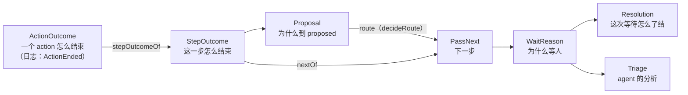

# Lingtai 的类型：一张票从"一步结束"到"等人处理"

> 草稿，定义中。**主干（第 1、4 节）刚按评审重写，待 review**；review 通过后，类型以本文为准：所有类型定完之前，[0118](../decisions/0118-a-hold-explains-itself.md) 和 [0120](../decisions/0120-a-reason-is-a-type.md) 里和本文不一致的地方都按本文读；定完后一次写回这两个 ADR。这里用代码讲清楚每个类型为什么存在。代码用 TypeScript 写成判别联合（`_tag`），实现时用 zod 定义在 `@lingtai/domain`。

## 原则

1. **原因是类型，不是字符串。** 代码只要按某个值分支，那个值就该是一个变体。
2. **证据跟着变体走。** `BuildRed` 带红的输出，`MergeConflict` 带冲突路径。不存在"某个字段只在某种情况下有值"。
3. **存事实，派生类别。** 类别（"要人拍板"还是"机器坏了"）由函数从事实算出来，不另外存。
4. **一个名字只表示一件事。** 看到变体名就知道它属于哪一层、说的是什么。不单独用 Held、Failure、Continue 这类通用词。
5. **页面词 = 列 id = 类型名。** 看板的列叫 _Waiting on you_，id 是 `waiting`，所以类型是 `WaitReason`、`WaitOnPerson`，事件是 `WaitTriaged`。_you_ 只留在页面上，日志和 CLI 没有固定的读者。**hold 只指 `agent:hold`**：人在领取前按住一张票，票还在 Queued。方向相反，是人让机器等。代码里现在的 `Hold`、`HoldTriaged`、`Held` 由 #450 改名。同理，`proposed` 这一步只叫 `proposed`，不再叫 router：到达它的是 `Proposal`。它做的事叫 route（动词），选出的是 `PassNext`，和其他 step 结束后的下一步同一个类型。
6. **决策是纯函数，副作用在外层。** 纯函数不读数据库、时钟、git 或进程；外层调用纯函数，再按结果行动。

## 一张票的流程



---

## 1. `ActionOutcome` 与 `StepOutcome`：日志记 action，决策读 step

**目的**：pass 跑完一步，要知道接下来是继续、到 proposed，还是停下。但一个 step 下可以有好几个 action：build 下跑 `pnpm test`、`pnpm typecheck`、`pnpm lint`，每个都有自己的结论和证据。所以分两层：**日志按 action 记，决策按 step 读。**

```ts
type ActionOutcome =
  | { _tag: 'Passed'; evidence: string; findings: Finding[] } // findings 只可能是 minor
  | { _tag: 'ChecksRefused'; evidence: string; findings: Finding[] } // 命令红了、reviewer 拒绝了
  | { _tag: 'AnswerUnreadable'; raw: string } // agent 的回答解析失败，是机器弄丢了
  | { _tag: 'AgentCommitted'; sha: string; said: string | null } // implement：agent 提交了改动
  | { _tag: 'AgentChangedNothing'; said: string | null } // implement：agent 跑完了，但没提交
  | { _tag: 'AgentAsked'; question: string } // design 或 implement 里 agent 提问
  | { _tag: 'AwaitingSignoff'; source: 'declared' | 'injected'; question: string } // human: 或 watch:
  | { _tag: 'RunEndedEarly'; kind: 'crash' | 'timeout' | 'out-of-turns' | 'out-of-usd'; detail: string }
  | { _tag: 'NeverStarted'; why: string } // 账号额度、环境不满足

// 日志：每个 action 跑完一次，一条
ActionEnded { runId, step, action, onSha, round, outcome: ActionOutcome, usage?: Usage, costUsd: number | null }

// 决策：一个 step 跑完一次，一个值，不进日志
type StepOutcome = { step: Step; decisive: { action: string; outcome: ActionOutcome } | null }
const stepOutcomeOf: (step: Step, ended: ActionEnded[]) => StepOutcome
```

`decisive` 是让这一步停下的那个 action：第一个不是 `Passed` 的；全部通过时取最后一个；这一步没有声明任何 action 时是 `null`，按通过处理。`nextOf` 和 `proposalOf` 只读 `StepOutcome`，证据从 `decisive` 里拿。

**为什么日志要按 action 记**：现在的 `Step*` 事件就是每个 action 一条，带 `{step, action, runId, onSha}`（`events.ts:629`）。`onSha` 说明这个结论是针对哪个 diff 的，force-push 之后旧结论自动失效，不会被继承。每个 action 也有自己的证据。上一版的 `StepEnded{step, outcome}` 每步只有一条，这两样都会丢。

**例子**：#500 的一个 pass。

| 第几次 | step                     | action（`ActionEnded`）                                                    | `StepOutcome.decisive`         |
| ------ | ------------------------ | -------------------------------------------------------------------------- | ------------------------------ |
| 1      | implement                | `implement`: `AgentCommitted{sha: a1}`                                     | 同左                           |
| 2      | build                    | `pnpm test`: `ChecksRefused{2 个失败}`                                     | `pnpm test` 的 `ChecksRefused` |
| 3      | implement（第 1 轮修复） | `implement`, round 1: `AgentCommitted{sha: b2}`                            | 同左                           |
| 4      | build                    | `pnpm test`: `Passed`；`pnpm typecheck`: `Passed`                          | `pnpm typecheck` 的 `Passed`   |
| 5      | review                   | `reviewer`: `ChecksRefused{findings}`                                      | 同左                           |
| 6      | implement（第 2 轮修复） | `implement`, round 2: `AgentChangedNothing{said: "ticket 写明只支持 ISO"}` | 同左                           |

**每种 action 能产生哪些结果，是一张表加一条测试，不是类型。** 一个联合类型挡不住 reviewer 产生 `AgentCommitted`。按插件分类型能让编译器挡住，但 `stepOutcomeOf`、`nextOf` 的签名都要变成泛型，不值。所以 `OUTCOMES_OF: Record<PluginKind, ActionOutcome['_tag'][]>` 写在 domain 里，一条单元测试要求每个 `ActionEnded` 的 outcome 都在它插件的那一行里。按插件而不是按 step 列，因为能产生什么由 action 是什么决定，一个 step 下可以有不同的插件：

| 插件                 | 能产生                                                                                                                                         |
| -------------------- | ---------------------------------------------------------------------------------------------------------------------------------------------- |
| `run:`（命令）       | `Passed`、`ChecksRefused`、`RunEndedEarly`（只有 `timeout`）、`NeverStarted`                                                                   |
| `agent:`（reviewer） | `Passed`、`ChecksRefused`、`AnswerUnreadable`、`RunEndedEarly`、`NeverStarted`                                                                 |
| implement、design    | `AgentCommitted`、`AgentChangedNothing`、`AgentAsked`、`RunEndedEarly`、`NeverStarted`（没有 `Passed`：implement 的通过就是 `AgentCommitted`） |
| `human:`、`watch:`   | `Passed`、`AwaitingSignoff`                                                                                                                    |

实现时这张表以 `packages/recipe/src/recipe.ts` 里的插件定义为准，上表是起点，不是定稿。

**`ActionEnded` 替换哪些事件**：现在的五个结束事件（`StepPassed`、`StepFailed`、`StepAsked`、`StepDidNotFinish`、`StepNeverRan`）、`FixApplied` 和 `RunFailed{kind: 'no-commits'}`。证据在 outcome 的变体里（原则 2），事件上不再另放 `evidence`。`StepFailed.unreadable` 变成 `AnswerUnreadable` 这个变体，不再是一个"只在某种失败时有值"的字段。`StepWaived` 保留：那是人推翻一次结论，不是一个 action 结束了。`FixDeclined`（没买修复轮次）是 route 的结果，由 `PassRouted` 的 `basis` 记录，实现时核对它是否还需要单独存在。事件名不加 `Event` 后缀：`EVENTS`（`events.ts:2185`）里约 70 个事件都是不带后缀的过去时，只给一个加会不一致，全加是一次全日志改名；过去时本身就说明它是事件。改形状要重置日志，所以属于 0120 第二期。

**事件和 `StepOutcome` 的区别**：事件在日志里，只追加，给投影和重放读；`StepOutcome` 是纯函数的输入，由 `stepOutcomeOf` 从这一步的 `ActionEnded` 折叠出来，不存。今天这一层对不上：implement 第一次派发的成功要从 `RunFinished` 加 `RunProducedDiff` 推出来，人签字没有自己的事件、直接写进 `WorkItemBlocked`，`proposed` 的决定写成 `PassRouted`。

**审视：合并。** 现在有两个类型描述同一件事：conductor 的 `StepEnding`，以及 0120 草稿里的 `FixOutcome`。"agent 跑完但没提交"在第一次派发时记成 `RunFailed{kind: 'no-commits'}`，在修复轮次里记成 `FixApplied{headSha: null, failure: null}`，两种写法表达同一个事实。现在都是 implement 这个 action 的一次 `ActionEnded`，修复轮次只是 `round` 大于 0，不需要单独的 `FixOutcome`。

---

## 2. `Proposal`：改动为什么到 proposed

**目的**：`proposed` 要根据"从哪一步来、为什么来"决定给哪些选项。同样是红，发生在 prepared 和发生在 build，可选的去向不一样；`InputNeeded` 要回到发问的那一步。

```ts
type ProposalReason =
  | { _tag: 'BuildRed'; output: string }
  | { _tag: 'VerifyRed'; output: string }
  | { _tag: 'ReviewFindings'; findings: Finding[] }
  | { _tag: 'ReviewEmpty'; said: string } // reviewer 拒绝了，但没有可执行的意见
  | { _tag: 'ReviewUnreadable'; raw: string } // 回答解析失败，是机器弄丢了
  | { _tag: 'MergeConflict'; paths: string[]; baseSha: string; headSha: string }
  | { _tag: 'InputNeeded'; question: string }

type Proposal = { from: Step; reason: ProposalReason }

const proposalOf: (outcome: StepOutcome) => Option<Proposal>
```

**`proposalOf` 的构造后条件**（不是类型保证）：给出 `ReviewFindings` 时，`findings` 里至少一条带失败场景；一条都没有的拒绝给出 `ReviewEmpty`。这条由 `proposalOf` 的单元测试固定。

**例子**：build 跑 `pnpm test`，2 个测试失败，得到 `Proposal{from: 'build', reason: BuildRed{output}}`。

**审视：保留，补一个变体。** `ReviewEmpty` 和 `ReviewUnreadable` 必须分开（`pass-steps.ts:837`）：前者是"reviewer 没话说"，后者是"机器把回答弄丢了"，人面对两者的处理不同。现在代码里 `ReviewEmpty` 混在 `findings` 里，用"没有一条带失败场景"来判断，这正是原则 1 说的"按值分支"。

**改名**：0120 草稿叫 `Arrived` / `Arrival` / `arrivalOf`，上一版本文叫 `RouterVisit`。`proposed` 这一步只用一个名字，所以到达它的东西叫 `Proposal`：改动被提交到 proposed，带着它从哪来、为什么来。WaitReason 里的 `RouterEscalated` 相应改为 `ProposedEscalated`。

`proposalOf` 只读 `StepOutcome`，所以可以放在 domain 里；它是唯一把一步的结果翻译成 `Proposal` 的地方。

---

## 3. route：proposed 怎么选下一步

**route 是动词，不是类型**：指 `proposed` 做选择这件事，只在 `proposed` 发生。选出来的结果是 `PassNext`（第 4 节），和其他 step 结束后的下一步是同一个类型。

**目的**：日志要分清"judge 选择交给人"和"judge 想再修一轮，被上限拦下"，所以选择本身之外还要记下它是怎么来的。

```ts
type RouteOffer = { reachable: Step[]; affordable: Step[] } // judge 只能看到 affordable

type RouteBasis =
  | { _tag: 'JudgeChose' }
  | { _tag: 'CeilingOverrode'; wanted: Step; ceiling: 'rounds' | 'restarts' } // 只有这两个是 route 的上限（pass.ts:973-974）
  | { _tag: 'ReplyRejected'; wanted: string } // judge 回答了一个不在选项里的去向

const offerFor: (proposal: Proposal, policy: RoutingPolicy) => RouteOffer
const decideRoute: (
  proposal: Proposal,
  offer: RouteOffer,
  reply: JudgeReply,
  ctx: RunContext,
) => { next: PassNext; basis: RouteBasis }
```

**例子**：reviewer 提了 major，judge 想回 implement 再修，还剩轮次，结果是 `{next: FixRound{round: 2}, basis: JudgeChose}`。3 轮已经用完时，结果是 `{next: WaitOnPerson{reason: ProposedEscalated{proposal, why}}, basis: CeilingOverrode{wanted: 'implement', ceiling: 'rounds'}}`，存成事件 `PassRouted`。

**审视：删掉 `Route` 类型。** 它的三个变体里，两个和 `PassNext` 的变体重复，`HandToPerson` 只是还没补上原因的 `WaitOnPerson`。分成两个类型，读代码的人要先弄懂这两个阶段是一回事，`nextOf` 也得同时接 `Route | StepOutcome` 两种互不相关的输入。现在 `decideRoute` 多接一个 `RunContext`，直接给出完整的 `PassNext`，交给人时当场生成 `ProposedEscalated`：在哪里决定交给人，就在哪里说清原因。`RouteOffer` 已经存在（`pass.ts:837`）。`Destination` 现在定义了三遍，统一成 `PassNext` 一处。`RouteBasis` 替代 `PassRouted` 里 `chose` 和 `to` 两个字段的比较，以及那个可空的 `ceiling` 字段。

`JudgeReply` 的来源：内置规则是纯函数；agent 是副作用（要花钱）；没有声明 judge 时，由外层合成一个"交给人"的回答。人不是 judge，人是 `WaitOnPerson` 的去向。

---

## 4. `PassNext`：下一步，花了什么一起写明

**目的**：pass 接下来做什么，只有这一个类型。普通 step 结束后由 `nextOf` 给出，`proposed` 由 `decideRoute` 给出。只有这两个函数能让票进入 Waiting。**它是完整的状态转换，不只是目的地**：会花预算的走法是单独的变体，花了哪一轮写在值里，conductor 不用再从"从哪来、到哪去"推一遍。

```ts
type PassNext =
  | { _tag: 'Advance'; to: Step } // 沿主线往前，不花预算：去下一步、去 proposed、去 merge
  | { _tag: 'FixRound'; round: number } // 回 implement，花掉第 round 轮修复
  | { _tag: 'RestartFromBase'; restart: number } // 从 base 开新 pass，花掉第 restart 次重开
  | { _tag: 'WaitOnPerson'; reason: WaitReason }

type RunContext = { run: RunRef; step: Step; proposal: Proposal | null; spent: Spent }

const nextOf: (outcome: StepOutcome, ctx: RunContext) => PassNext
const spentAfter: (spent: Spent, next: PassNext) => Spent // FixRound、RestartFromBase 各加一，其余不变
```

`Advance.to` 只能是主线上更靠后的 step，这一点由 `nextOf`、`decideRoute` 的穷举测试固定，不是类型保证。往回走只有两种：回 implement 是 `FixRound`，回 claim 是 `RestartFromBase`。`round` 和 `restart` 等于 `spent` 里的数加一，由给出它的函数算，`spentAfter` 照着值更新，不再判断。

**例子**：

- build 结束，`Passed`：`Advance{to: 'review'}`。
- build 结束，`ChecksRefused`：`Advance{to: 'proposed'}`，由 `proposed` 去 route。
- `proposed` 决定再修一轮，这是第 2 轮：`FixRound{round: 2}`。
- `proposed` 决定思路错了要重来：`RestartFromBase{restart: 1}`。
- implement 里 agent 提问，`AgentAsked`：`WaitOnPerson{reason: AgentQuestion{…}}`。

**审视：保留，替代 0120 草稿里的 `transitionOf`。** 上一版的 `GoToStep{to}` 只是目的地：`GoToStep{to: 'implement'}` 本身不说花了一轮，conductor 要拿 `to` 和当前 step 比较才知道，这正是原则 1 反对的"靠组合推出含义"。拆成 `Advance`、`FixRound`、`RestartFromBase` 之后，花了什么直接写在值里。"谁把票交给人"这条分类规则分在两处：`ProposedEscalated` 在 `decideRoute` 里生成，其余的在 `nextOf` 里生成。两个函数各有穷举测试，合起来覆盖 `WaitReason` 的每个变体。

---

## 5. `WaitReason`：为什么等你

**目的**：卡片、允许的处理、默认推荐、要不要跑 triage，全都由它决定。

```ts
type WaitReason =
  // 有人在问问题
  | { _tag: 'OwnQuestion'; question: string; by: string } // 人自己用 lingtai ask 提的
  | { _tag: 'AgentQuestion'; run: RunRef; step: Step; question: string }
  // 要人拍板
  | { _tag: 'SignoffRequired'; run: RunRef; step: Step; source: 'declared' | 'injected'; question: string }
  | { _tag: 'FixerDisagrees'; run: RunRef; step: Step; said: string | null }
  | { _tag: 'ProposedEscalated'; run: RunRef; proposal: Proposal; why: string }
  // 机器出了问题，没有人做过判断
  | {
      _tag: 'MergeRefused'
      run: RunRef
      reason: RefusalReason
      paths: string[] | null
      baseSha: string | null
      headSha: string | null
      afterApproval: boolean
      raw: string | null
    }
  | {
      _tag: 'BudgetExhausted'
      run: RunRef
      kind: 'out-of-turns' | 'out-of-usd'
      detail: string // runtime 自己说的停止原因，原样保留
      turns: number | null
      costUsd: number | null
    }
  | { _tag: 'AgentCrashed'; run: RunRef; step: Step; kind: 'crash' | 'timeout'; detail: string }
  | { _tag: 'SetupRefused'; run: RunRef; step: Step; lifts: 'by-itself' | 'person'; why: string }

type WaitKind = 'question' | 'decision' | 'fault'
const waitKind: (reason: WaitReason) => WaitKind // 派生，不存
```

**例子**：

- 测试修了 3 轮还是红的：`ProposedEscalated{proposal: {from: 'build', reason: BuildRed}}`
- agent 撞到 250 轮上限：`BudgetExhausted{kind: 'out-of-turns', turns: 251}`
- 有人批准了合并，合并仍然冲突：`MergeRefused{reason: 'conflict', afterApproval: true}`

**`waitKind` 分三类**，只给卡片文案和看板分组用，没有逻辑按它分支：

| `WaitKind` | 变体                                                              | 卡片上说     |
| ---------- | ----------------------------------------------------------------- | ------------ |
| `question` | `OwnQuestion`、`AgentQuestion`                                    | 有人在问你   |
| `decision` | `SignoffRequired`、`FixerDisagrees`、`ProposedEscalated`          | 要你拍板     |
| `fault`    | `MergeRefused`、`BudgetExhausted`、`AgentCrashed`、`SetupRefused` | 机器出了问题 |

`question` 单独一类，因为人面对它要做的是回答，不是在几个去向里选。评审建议在有行为按它分支之前不加；但 `waitKind` 本身只服务卡片文案，`decision` 和 `fault` 同样没有行为按它们分支，按那个标准三类都该删。卡片上"有人在问你"和"要你拍板"是两种不同的提示，所以保留。注意两种问题的回答方式不同：`OwnQuestion` 用 `AnswerQuestion`，`AgentQuestion` 用 `EditBodyAndRequeue`，因为 agent 只读得到正文（`prompt.ts:275`）。所以"能不能 `AnswerQuestion`"由 `allowedResolutions` 按变体决定，不按 `waitKind`。

**审视：三处调整。**

1. **已经是平的，只删分组 schema。** 日志里的 `Hold` 已经是一层 `_tag` 联合：`hold.ts:263` 把 `Judgement.options` 和 `Failure.options` 展开进去，没有 `{_tag: 'Failure', failure: …}` 这层包装。`Judgement`、`Failure` 只是构造时用的分组 schema，没有代码按它们分支，卡片文案改由 `waitKind` 派生（原则 3）。所以要做的只是：`Hold` → `WaitReason`、变体改名、删掉这两个分组 schema。变体名会写进日志（`WorkItemBlocked`），放进 0120 第二期那一次重置一起做。
2. **删掉 `CheckRed`。** 按方案 B，build 红了、轮次用完归 `ProposedEscalated{BuildRed}`；合并时的检查红了归 `MergeRefused{reason: 'verify-failed'}`。剩下没有地方会产生它，由 #452 确认后删除。
3. **`DidNotFinish` 拆开。** 现在一个变体装了崩溃和撞上限两种情况。两者的处理不同：崩溃一般重跑，撞上限要先把票拆小。所以撞上限归 `BudgetExhausted`，崩溃归 `AgentCrashed`，"选择不改"归 `FixerDisagrees`。

---

## 6. `Resolution`：这次等待怎么了结

**目的**：卡片上的按钮。由 `allowedResolutions(reason)` 决定有哪些，`recommendedResolution` 决定先推荐哪个。

```ts
type Resolution =
  | { _tag: 'Approve' } // 合进 main
  | { _tag: 'Requeue' } // 从 base 重新做
  | { _tag: 'EditBodyAndRequeue' } // 先改正文，再重新做
  | { _tag: 'AnswerQuestion'; choice: string } // 只对 OwnQuestion 有效
  | { _tag: 'Close' }

const allowedResolutions: (reason: WaitReason) => Resolution[]
const recommendedResolution: (reason: WaitReason, triage: TriageStatus) => Resolution | null
```

**例子**：`FixerDisagrees` 允许 `[Approve, Requeue, EditBodyAndRequeue, Close]`。Approve 表示站 fix agent 这边，EditBodyAndRequeue 表示站 reviewer 这边。

**审视：改名为 `Resolution`。** `Move` 只说"走一步"，看不出谁走、往哪走，还和 route、看板拖卡片撞词。`Resolution` 说的是这次等待怎么了结，每个变体都是结束等待的一种方式。另外 `BodyAndRequeue` 改为 `EditBodyAndRequeue`，让名字说清先做什么；`Answer` 改为 `AnswerQuestion`，它只对 `OwnQuestion` 有效。`Approve`、`Requeue`、`Close` 不变，和 CLI 命令、看板按钮同名。

---

## 7. Triage：agent 对等待原因的分析

**目的**：花钱请 agent 读等待原因，指出根本原因，推荐一个处理。它只给建议，不会移动票。

```ts
type RootCause =
  | { _tag: 'UndecidedQuestion'; questions: Question[] } // 票里有没定的问题
  | { _tag: 'FixableLines'; fixes: LineFix[] } // 改几行就好
  | { _tag: 'WrongApproach' } // 思路错了，要重来
  | { _tag: 'ConflictingHunks'; hunks: Hunk[]; total: number }
  | { _tag: 'TicketTooBig' } // 要拆票
  | { _tag: 'SetupBroken' }

type TriageResult =
  | { _tag: 'TriageFailed'; why: string }
  | { _tag: 'TriageAdvised'; cause: RootCause; resolution: Resolution; summary: string }

type TriageStatus =
  // 读取时推导，不存
  | { _tag: 'NotDeclared' }
  | { _tag: 'Queued' }
  | { _tag: 'Running' }
  | { _tag: 'Interrupted' }
  | { _tag: 'Done'; result: TriageResult }

const triageRuns: (reason: WaitReason) => boolean
```

**例子**：`MergeRefused{reason: 'conflict'}` 有 3 个冲突块，triage 返回 `TriageAdvised{cause: ConflictingHunks{hunks, total: 3}, resolution: Requeue}`。

**审视：保留，只改名。** `Cause` 的变体现在叫 `Decision`、`Lines`、`Narrower`，单独看不出意思，按原则 4 改成上面的名字。

---

## 第一性审视：结论

| 类型                               | 结论                                                                                  | 理由                                                                      |
| ---------------------------------- | ------------------------------------------------------------------------------------- | ------------------------------------------------------------------------- |
| `StepEnding` + `FixOutcome`        | **合并**：日志按 action 记 `ActionEnded`，`StepOutcome` 由 `stepOutcomeOf` 折叠，不存 | 修复轮次就是 implement 再跑一次；`onSha` 和每个 action 的证据要留在日志里 |
| `Arrival` / `Arrived`              | 保留，改名为 `ProposalReason` / `Proposal`，并加 `ReviewEmpty`                        | `proposed` 需要知道来源；"没话说"和"弄丢了"要分开                         |
| `Route` + `RouteDecision`          | **删掉** `Route`，`RouteDecision` 改名为 `RouteBasis`；route 只作动词                 | `Route` 和 `PassNext` 重复；日志要分清是 judge 的选择，还是被上限拦下     |
| `transitionOf` 的结果              | **替换**为 `PassNext`（`Advance`、`FixRound`、`RestartFromBase`、`WaitOnPerson`）     | 下一步只有这一个类型，花了什么预算写在值里                                |
| `Hold` / `HoldTriaged` / `Held`    | **改名**为 `WaitReason` / `WaitTriaged` / `Waiting`                                   | 和看板的 _Waiting on you_ 列对上；hold 只留给 `agent:hold`                |
| `Judgement`、`Failure` 分组 schema | **删除**，卡片分类由 `waitKind` 派生                                                  | 日志里已经是平的，没有代码按分组分支                                      |
| `CheckRed`                         | **删除**（等 #452 确认）                                                              | 方案 B 之后没有地方会产生它                                               |
| `DidNotFinish`                     | **拆开**为 `AgentCrashed` / `BudgetExhausted` / `FixerDisagrees`                      | 三种情况，三种不同的处理                                                  |
| `Move`                             | **改名**为 `Resolution`，变体 `EditBodyAndRequeue`、`AnswerQuestion`                  | 名字要说清是"等待怎么了结"，不和 route 撞词                               |
| `TriageResult`、`TriageStatus`     | 保留                                                                                  | 已经是该有的形状                                                          |
| `Cause`                            | 保留，改名为 `RootCause`，变体也改名                                                  | 现在的名字单独看不出意思                                                  |

## 待你决定

暂无。新的问题出现时加在这里。
