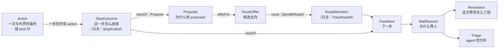

# Lingtai 的类型：一张票从"一步结束"到"等人处理"

> 草稿，定义中。**主干（第 1–4 节和第 8、9 节）按第三轮评审收紧，待 review**；review 通过后，类型以本文为准：所有类型定完之前，[0118](../decisions/0118-a-hold-explains-itself.md) 和 [0120](../decisions/0120-a-reason-is-a-type.md) 里和本文不一致的地方都按本文读；定完后一次写回这两个 ADR。这里用代码讲清楚每个类型为什么存在。代码用 TypeScript 写成判别联合（`_tag`），实现时用 zod 定义在 `@lingtai/domain`。

## 原则

1. **原因是类型，不是字符串。** 代码只要按某个值分支，那个值就该是一个变体。
2. **证据跟着变体走。** `BuildRed` 带红的输出，`MergeConflict` 带冲突路径。不存在"某个字段只在某种情况下有值"。
3. **存事实，派生类别。** 类别（"要人拍板"还是"机器坏了"）由函数从事实算出来，不另外存。
4. **一个名字只表示一件事。** 看到变体名就知道它属于哪一层、说的是什么。不单独用 Held、Failure、Continue 这类通用词。
5. **页面词 = 列 id = 类型名。** 看板的列叫 _Waiting on you_，id 是 `waiting`，所以类型是 `WaitReason`、`WaitOnPerson`，事件是 `WaitStarted`。_you_ 只留在页面上，日志和 CLI 没有固定的读者。**hold 只指 `agent:hold`**：人在领取前按住一张票，票还在 Queued。方向相反，是人让机器等。代码里现在的 `Hold`、`HoldTriaged`、`Held` 由 #450 改名。同理，`proposed` 这一步只叫 `proposed`，不再叫 router：到达它的是 `Proposal`。它做的事叫 route（动词），选出的是 `PassNext`，和其他 step 结束后的下一步同一个类型。
6. **决策是纯函数，副作用在外层。** 纯函数不读数据库、时钟、git 或进程；外层调用纯函数，再按结果行动。
7. **互斥的用判别联合，能同时发生的用并列的字段。** 一次 agent 运行可以既提交了改动又提了问题，这两件事不能做成一个联合里的两个变体，否则其中一件就丢了。也不能反过来，为了用上判别联合把正交的事实硬拼成互斥。

## 一张票的流程



调用方看不到这张图里的任何一个函数，只调 `runPass`（第 9 节）。这些类型定义的是日志里存的事实和 `runPass` 内部的纯函数。

---

## 1. `Action` 与 `StepOutcome`：一步结束，一条事件，带上它的每个 action

**目的**：pass 跑完一步，要知道接下来是继续、到 proposed，还是停下。一个 step 下可以有好几个 action：build 下跑 `pnpm test`、`pnpm typecheck`、`pnpm lint`，每个都是一次与外界的操作。所以分两个类型：**`Action` 是一次操作，`StepOutcome` 是一步的结束，`StepOutcome` 包含这一步的所有 action**。日志里只有 step 结束的事件，action 不单独成事件。

**`Action` 按 kind 分，每种 kind 只能有它会有的结果。** 能同时发生的事（agent 既提交了改动又提了问题）是同一个变体里的两个字段（原则 7）；不会发生的组合（reviewer 合进了 main、没轮到跑的 action 带着提交）在类型上写不出来。

```ts
type Assessment = { verdict: 'accepted' | 'refused'; evidence: string; findings: Finding[] } // 命令或 reviewer 的结论
type TreeAdvanced = { from: string; to: string } // agent 提交了改动，分支从 from 走到 to
type Design = { document: string; locator?: string } // document 和 locator 必须来自同一个 action（action.ts:212）；"" 是"不需要设计"，不是缺失
type Integration =
  | { _tag: 'Integrated'; mergeSha: string }
  | { _tag: 'IntegrationRefused'; reason: RefusalReason; paths: string[] | null; baseSha: string; headSha: string; raw: string | null }

// 任何 kind 都可能有的两种结局
type NeverStarted = { _tag: 'NeverStarted'; scope: 'conductor' | 'work-item'; why: string } // 账号额度、环境不满足
type NotReached = { _tag: 'NotReached' } // 前面有 action 没过关，这个没轮到跑
type Interrupted = { _tag: 'Interrupted'; cause: 'crash' | 'timeout' | 'out-of-turns' | 'out-of-usd'; detail: string } // 不叫 kind：kind 是 Action 的判别字段（原则 4）

type ActionBase = {
  name: string // recipe 里写的那个：'pnpm test'、'reviewer'、'implement'
  onSha: string | null // 这个结论针对哪个 diff；没跑的是 null
  call: CallId | null // 这次操作花钱的那次调用，收据见 #455；命令、合并、人签字为 null
}

type Action = ActionBase &
  (
    | { kind: 'run'; result: { _tag: 'Completed'; assessment: Assessment } | (Interrupted & { cause: 'timeout' }) | NeverStarted | NotReached }
    | {
        kind: 'reviewer'
        result:
          | { _tag: 'Completed'; assessment: Assessment; said: string | null }
          | { _tag: 'AnswerUnreadable'; raw: string } // 跑完了，但回答解析失败，是机器弄丢了
          | Interrupted | NeverStarted | NotReached
      }
    | {
        kind: 'implement'
        result:
          | { _tag: 'Completed'; advanced: TreeAdvanced | null; question: string | null; said: string | null }
          | (Interrupted & { advanced: TreeAdvanced | null }) // 提交了一部分再超时，分支上就是有提交
          | NeverStarted | NotReached
      }
    | {
        kind: 'design'
        result:
          | { _tag: 'Completed'; design: Design | null; question: string | null; said: string | null }
          | Interrupted | NeverStarted | NotReached
      }
    | { kind: 'signoff'; source: 'declared' | 'injected'; result: { _tag: 'Completed'; requested: { question: string } | null } | NotReached } // human: 或 watch:；requested 为 null 是已经签过
    | { kind: 'merge'; result: { _tag: 'Completed'; integration: Integration } | NeverStarted | NotReached }
  )

// 一步的结束：这一步声明的每个 action，按声明顺序，没跑的也在
type StepOutcome = { step: Step; round: number; actions: Action[] }

// 日志：一个 step 跑完一次，一条
StepEnded { runId, outcome: StepOutcome }
```

**judge 条目不是 action**：`judge:` 声明在 `proposed:` 下面，但只在 route 时被问（第 3 节），正常经过 proposed 时不跑，也不出现在 `StepOutcome.actions` 里。

kind 和插件的对应：`run:` 是 `run`，`agent:` 在 review 是 `reviewer`、在 implement 是 `implement`、在 design 是 `design`，`human:` 和 `watch:` 是 `signoff`，merge 插件是 `merge`。claim 和 admit 的插件（queue、worktree）实现时按同样的方式补成 kind；以 `packages/recipe/src/recipe.ts` 里的插件定义为准。

**"过关"（cleared）是派生的**：`cleared(action)` 是一个纯函数，不存，按 kind 判断：

| kind              | 过关                                                  |
| ----------------- | ----------------------------------------------------- |
| `run`、`reviewer` | `Completed` 且 `assessment.verdict` 是 `accepted`     |
| `implement`       | `Completed`，`advanced` 不为 null，`question` 为 null |
| `design`          | `Completed`，`design` 不为 null，`question` 为 null   |
| `signoff`         | `Completed` 且 `requested` 为 null                    |
| `merge`           | `Completed` 且 `integration` 是 `Integrated`          |

其余情况都没过关。检查绿了、agent 提交了改动、merge 合进去了，都是过关。不叫 passed：pass 在这里已经是名词，指一张票从 claim 到 end 的一趟（`PassNext`、`PassRouted`、`runPass`），再让 action "passed" 就是一个词两个意思（原则 4）。

**一步最多一个 action 没过关，不用挑。** 同一个 step 里，一个 action 没过关，后面的就不再跑（`pass-steps.ts:719`："pipeline stops at the first action that did not pass"），后面的都记成 `NotReached`。所以没过关的就是最后一个不是 `NotReached` 的 action；它也过关了，这一步就全部过关；这一步没有声明任何 action 时 `actions` 为空，按全部过关处理。fold 和 `nextOf` 都直接读，不需要另存一个 `decisive` 字段。声明了几个、跑了几个、哪个没过关，都能从 `actions` 直接数出来。

**"没改东西"不是事实，是解读**：fix 轮次里 agent 跑完了但没有提交，记成 `Completed{advanced: null, question: null, said}`。"fix agent 不同意 reviewer"是 `nextOf` 对它的解读，据此给出 `FixerDisagrees`，日志里不另造一个 `AgentChangedNothing`。

**`onSha` 跟着 action 走，不跟着 step 走**：现在的 `Step*` 事件每个 action 一条，带 `{step, action, runId, onSha}`（`events.ts:629`）。`onSha` 说明结论针对哪个 diff，force-push 之后旧结论自动失效，不会被继承。implement 中途会 commit，同一 step 里 sha 可能变，所以每个 `Action` 自己带。

**中途崩溃不补事件**：conductor 死在一个 step 中间时，这一步没有 `StepEnded`。下一个 conductor 从日志里最后一条 `StepEnded` 接着走，也就是把被打断的这一步整步重跑。已跑完的 action 的结论不进日志，这一点按 action 记事件也一样：死在 action 中间的那一个照样什么都没留下，所以不为它多一种事件或变体。花费不受影响：每次付费调用结束时就写下自己的收据（#455），不等 `StepEnded`。

**花费只有一个来源**：`Action` 不带 `usage`、`costUsd`，只用 `call` 引用那次调用的收据。收据由 #455 定义：一次付费调用一张，`Reported(0)` 和 `NotReported` 分开，run、step、轮次的花费都由投影求和。`RunFinished` 等事件上现有的 `costUsd` 由 #455 一并收走，否则同一笔钱会记两次。

**例子**：#500 的一个 pass。build 声明了 `pnpm test`、`pnpm typecheck` 两个。

| 第几次 | `StepEnded.outcome`                                                                                   |
| ------ | ----------------------------------------------------------------------------------------------------- |
| 1      | implement, round 0：`implement` `Completed{advanced: a0→a1}`                                          |
| 2      | build, round 0：`pnpm test` `Completed{assessment: refused, 2 个失败}`；`pnpm typecheck` `NotReached` |
| 3      | implement, round 1：`implement` `Completed{advanced: a1→b2}`                                          |
| 4      | build, round 1：`pnpm test` `Completed{accepted}`；`pnpm typecheck` `Completed{accepted}`             |
| 5      | review, round 1：`reviewer` `Completed{assessment: refused, findings}`                                |
| 6      | implement, round 2：`implement` `Completed{advanced: null, said: "ticket 写明只支持 ISO"}`            |

另一个 pass：agent 提交了一半改动，然后对剩下的部分提问：`implement` `Completed{advanced: c1→c2, question: "…"}`。旧的 `ActionOutcome` 只能在 `AgentCommitted` 和 `AgentAsked` 里选一个，丢掉另一个。

**`StepEnded` 替换哪些事件**：见第 8 节。证据在变体里（原则 2），事件上不再另放 `evidence`。`StepFailed.unreadable` 变成 `AnswerUnreadable` 这个变体，不再是一个"只在某种失败时有值"的字段。事件名不加 `Event` 后缀：`EVENTS`（`events.ts:2185`）里约 70 个事件都是不带后缀的过去时，只给一个加会不一致，全加是一次全日志改名；过去时本身就说明它是事件。

**审视：合并，并按 kind 收紧。** 现在有两个类型描述同一件事：conductor 的 `StepEnding`，以及 0120 草稿里的 `FixOutcome`。"agent 跑完但没提交"在第一次派发时记成 `RunFailed{kind: 'no-commits'}`，在修复轮次里记成 `FixApplied{headSha: null, failure: null}`，两种写法表达同一个事实。现在都是 implement 这一步的一条 `StepEnded`，修复轮次只是 `round` 大于 0。更早一版的 `ActionOutcome` 有 9 个互斥变体，把"执行怎么结束"和"产出了什么"拼在一起，违反原则 7；上一版拆成 `execution` 加任意的 `products` 列表，又能拼出 `NotReached` 带 `Integrated`、reviewer 产出合并这类非法组合，只能靠一张表加测试挡，挡不住事件 schema 和以后的 writer。按 kind 分成普通联合之后，`nextOf` 照样读 `Action[]`，不需要泛型，那张表和测试也不再需要。

---

## 2. `Proposal`：改动为什么到 proposed

**目的**：`proposed` 要根据"从哪一步来、为什么来"决定给哪些候选去向。`InputNeeded` 要回到发问的那一步，`MergeConflict` 只可能来自 merge。

**相关联合，不是 `{from, reason}`**：上一版的 `{from: Step; reason}` 允许 `from: 'design'` 配 `BuildRed` 这种不可能的组合。现在每个变体自己写死它能来自哪一步：

```ts
type Proposal =
  | { _tag: 'BuildRed'; from: 'build'; output: string }
  | { _tag: 'ReviewFindings'; from: 'review'; findings: Finding[] }
  | { _tag: 'ReviewEmpty'; from: 'review'; said: string } // reviewer 拒绝了，但没有可执行的意见
  | { _tag: 'ReviewUnreadable'; from: 'review'; raw: string } // 回答解析失败，是机器弄丢了
  | { _tag: 'InputNeeded'; from: 'design' | 'implement'; question: string }
  | { _tag: 'MergeConflict'; from: 'merge'; paths: string[]; baseSha: string; headSha: string }
  | { _tag: 'VerifyRed'; from: 'merge'; output: string } // base 动了，在新 base 上重跑检查红了
```

五个 `JudgeWhen`（`hold.ts:58`）与它对应：`red` 是 `BuildRed`，`verify-failed` 是 `VerifyRed`，`conflict` 是 `MergeConflict`，`needs-input` 是 `InputNeeded`，`findings` 是三个 `Review*`。

**一步怎么得到 Proposal**：没有单独的 `proposalOf`，是 `nextOf` 的 `Propose` 那一支（第 4 节）。先看最后一个不是 `NotReached` 的 action；它过关了就没有 Proposal。没过关时按"哪一步、执行怎么结束、产出了什么"对表：

| step               | 停下的 action                                                            | Proposal                                                                   |
| ------------------ | ------------------------------------------------------------------------ | -------------------------------------------------------------------------- |
| build              | `run` `Completed{assessment: refused}`                                   | `BuildRed{output: evidence}`                                               |
| review             | `reviewer` `Completed{assessment: refused}`，至少一条 finding 带失败场景 | `ReviewFindings`                                                           |
| review             | `reviewer` `Completed{assessment: refused}`，一条都不带                  | `ReviewEmpty{said}`                                                        |
| review             | `reviewer` `AnswerUnreadable`                                            | `ReviewUnreadable{raw}`                                                    |
| design / implement | `Completed`，`question` 不为 null                                        | `InputNeeded{question}`（`advanced` 不为 null 也一样，提交照样留在分支上） |
| merge              | `Completed{integration: IntegrationRefused{conflict}}`                   | `MergeConflict`                                                            |
| merge              | `Completed{integration: IntegrationRefused{verify-failed}}`              | `VerifyRed`                                                                |
| 其余               | 见第 4 节"不去 proposed 的那一支"                                        | 没有 Proposal：`nextOf` 直接给出 `WaitOnPerson`、`Requeued` 或 `Landed`    |

"至少一条带失败场景"这条分界由 `nextOf` 的单元测试固定，不是类型保证。

**和现在代码的一处差别**：现在 review 不拒绝任何东西，findings 是在 `proposed` 的正常经过里判的（`pass-steps.ts:602`："`review` refuses nothing, so it never arrives — its findings are judged on `proposed`'s own way through"），重开也只在那条路上提供（`pass.ts` 的 `onOffer`）。本文改成 reviewer 拒绝就 `Propose{ReviewFindings}`，由 offer 提供重开，语义等价，但实现时要把"正常经过 proposed 时判 findings"那段搬过来，不能两处都判。

**实现时核对**：`ARRIVE_AT_THE_ROUTER`（`pass.ts:1012`）里还有 `admit` 和 `prepared`。上表没有给它们 Proposal 变体：prepared 的拒绝现在按 `SetupRefused` 直接交给人。如果它们确实会到 proposed，要补变体，而不是放宽 `from`。

**例子**：build 跑 `pnpm test`，2 个测试失败，得到 `BuildRed{from: 'build', output}`。

**审视：保留，改成相关联合，补 `ReviewEmpty`。** `ReviewEmpty` 和 `ReviewUnreadable` 必须分开（`pass-steps.ts:837`）：前者是"reviewer 没话说"，后者是"机器把回答弄丢了"，人面对两者的处理不同。`ProposalReason` 这个类型删掉，它的变体直接成为 `Proposal`。

**改名**：0120 草稿叫 `Arrived` / `Arrival` / `arrivalOf`，再早叫 `RouterVisit`。WaitReason 里的 `RouterEscalated` 相应改为 `ProposedEscalated`。

---

## 3. route：proposed 怎么选下一步

**route 是动词，不是类型**：指 `proposed` 做选择这件事，只在 `proposed` 发生。

**目的**：judge 只能在 workflow 给的候选里选，日志要能分清"judge 选的"和"judge 选不了、交给人"以及为什么。

```ts
type CandidateId = string // 比如 'fix-lines'、'restart'、'hand-to-person'

// 候选能去的地方：再走一轮、从 base 重来、交给人；不含 Advance、Landed 这类主线上的去向
type CandidateNext =
  | Extract<PassNext, { _tag: 'FixRound' }>
  | { _tag: 'Requeued'; cause: Extract<RequeueCause, { _tag: 'Restart' }> }
  | { _tag: 'HandToPerson' } // 占位：offer 在 judge 回答之前算出，这时还没有交给人的原因

type RouteCandidate = { id: CandidateId; next: CandidateNext } // next 已经带好要花的那一轮
type ExcludedCandidate = { id: CandidateId; because: { _tag: 'CeilingReached'; ceiling: 'rounds' | 'restarts' } } // 只有这两个是 route 的上限（pass.ts:973-974）

type RouteOffer = { proposal: Proposal; available: RouteCandidate[]; unavailable: ExcludedCandidate[] }

type JudgeReply =
  { _tag: 'Selected'; candidate: CandidateId; why: string } | { _tag: 'Unreadable'; raw: string } | { _tag: 'NoJudge' } // 没声明 judge，由外层合成

// 只存决定本身，不存 next：next 从同一条事件里存下的 offer 查出来
type RouteDecision =
  | { _tag: 'Selected'; candidate: CandidateId } // candidate 必须在 offer.available 里
  | {
      _tag: 'Escalated'
      because:
        | { _tag: 'NoJudge' }
        | { _tag: 'UnreadableReply'; raw: string }
        | { _tag: 'UnknownCandidate'; candidate: string } // judge 选了一个 offer 里没有的 id
        | { _tag: 'CandidateUnavailable'; excluded: ExcludedCandidate } // judge 选了被上限挡掉的那个
    }

const offerFor: (proposal: Proposal, policy: RoutingPolicy, spent: Spent) => RouteOffer
const decideRoute: (offer: RouteOffer, reply: JudgeReply) => RouteDecision
// Selected 查 offer，HandToPerson 换成带原因的 WaitOnPerson；Escalated 生成 WaitOnPerson
const routeNext: (
  offer: RouteOffer,
  reply: JudgeReply,
  decision: RouteDecision,
) => Extract<PassNext, { _tag: 'FixRound' | 'Requeued' | 'WaitOnPerson' }>
```

**为什么这样**：

- judge 从候选 id 里选，不返回任意一个 Step。"回答不在选项里"变成 `UnknownCandidate`，不需要拿回答和两个数组比对。
- **哪些候选**（`pass.ts:925` 起的 `onOffer` 表）：再走一轮回到发问的那一步（`InputNeeded`），回 implement（implement 及之后的 step），从 merge 回 build（agent 解决冲突写的代码是 review 之后写的，要重新过 build 和 review），从 base 重来（只对 `ReviewFindings`），交给人（永远在）。
- 预算在 `offerFor` 里算完：可用的候选已经带着 `FixRound{round: 3}`，被上限挡掉的进 `unavailable`。`decideRoute` 只需要 offer 和回答，不再需要 `RunContext`，也不会再解释一遍上限。
- **决定里不存 `next`**：如果 `Selected` 同时存 `candidate` 和 `next`，就能写出 `fix-lines` 配 `Landed` 这种对不上的值。现在 `next` 只有一个来源，就是存下的 offer 里那个候选的 `next`，由 `routeNext` 查出。候选的去向收窄成 `CandidateNext`，offer 里放不进 `Advance` 或 `Landed`。
- **交给人的候选是占位**：offer 在 judge 回答之前算出，`hand-to-person` 这时给不出原因。`routeNext` 拿到 judge 的回答后，把 `HandToPerson` 换成 `WaitOnPerson{reason: ProposedEscalated{proposal, because: JudgeHandedOver{why}}}`。
- **类型挡不住的一处**：`Selected.candidate` 是不是 `offer.available` 里的 id。id 是数据，这只能由 `decideRoute` 在运行时保证：不在里面就是 `UnknownCandidate`，不会生成 `Selected`。由 `decideRoute` 的穷举测试固定。
- `Escalated` 一定交给人：`routeNext` 对它只生成 `WaitOnPerson`，原因是 `ProposedEscalated{proposal, because}`，`because` 就是 `Escalated.because`，类型原样带过去；`InputNeeded` 没有 judge 时是 `AgentQuestion`，比 `ProposedEscalated` 更具体。

**例子**：

- reviewer 提了 major，judge 选 `fix-lines`，还剩轮次：offer 里 `fix-lines` 的 `next` 是 `FixRound{round: 2}`，决定是 `Selected{candidate: 'fix-lines'}`。
- 3 轮已经用完，judge 仍选 `fix-lines`：`fix-lines` 在 `unavailable` 里，决定是 `Escalated{because: CandidateUnavailable{excluded: {id: 'fix-lines', because: CeilingReached{rounds}}}}`，`routeNext` 给出 `WaitOnPerson{reason: ProposedEscalated{because: CandidateUnavailable{…}}}`。
- build 红了，没有声明 judge，内置规则 `same-worktree`（`judge.ts:466`）作为 judge 回答 `Selected{candidate: 'fix-lines'}`。

`JudgeReply` 的来源：内置规则是纯函数；agent 是副作用（要花钱）；没有声明 judge 时，外层合成 `NoJudge`。人不是 judge，人是 `WaitOnPerson` 的去向。offer、回答和决定都是发生过的事实，三者一起存进 `PassRouted`（第 8 节）；`next` 不存，重放时由 `routeNext(offer, reply, decision)` 算出。

**审视：删掉 `Route` 和 `RouteBasis`。** `Route` 的三个变体里两个和 `PassNext` 重复，`HandToPerson` 只是还没补上原因的 `WaitOnPerson`。`RouteBasis` 和 `next` 组成的笛卡尔积允许非法组合，由 `RouteDecision` 的两个变体取代。`RouteOffer` 已经存在（`pass.ts:837`），这里把它从"两个 Step 数组"改成"带 id 的候选"。

---

## 4. `PassNext`：下一步，花了什么一起写明

**目的**：pass 接下来做什么，只有这一个类型，包括终态。**它是完整的状态转换，不只是目的地**：会花预算的走法是单独的变体，花了哪一轮写在值里。

```ts
type PassNext =
  | { _tag: 'Advance'; to: Step } // 沿主线往前，不花预算，不带原因：去下一步、去 merge，或 review 全部过关后经过 proposed
  | { _tag: 'Propose'; proposal: Proposal } // 带着原因去 proposed，由它 route
  | { _tag: 'FixRound'; to: 'design' | 'implement' | 'build'; round: number } // 往回走一步再来，花掉本 pass 的第 round 轮
  | { _tag: 'Requeued'; cause: RequeueCause } // 释放领取，票回队列：终态
  | { _tag: 'WaitOnPerson'; reason: WaitReason } // 票进 Waiting：终态
  | { _tag: 'Landed'; integrated: string } // 合进 main：终态；mergeSha 必须来自同一 pass 的 Integrated 产出

type RequeueCause =
  | { _tag: 'Restart'; restart: number } // proposed 决定思路错了，从 base 重来，花掉第 restart 次重开
  | { _tag: 'NeverStarted'; scope: 'conductor' | 'work-item'; why: string } // 和 diff 无关；scope 为 conductor 时 conductor 同时暂停

const nextOf: (
  outcome: StepOutcome,
  run: RunRef,
) => Extract<PassNext, { _tag: 'Advance' | 'Propose' | 'WaitOnPerson' | 'Requeued' | 'Landed' }>
const spentAfter: (spent: Spent, next: PassNext) => Spent // FixRound、Requeued{Restart} 各加一，其余不变
```

**`nextOf` 收窄**：普通 step 结束后不会直接花预算。build 红了是 `Propose{BuildRed}`，回 implement 修是 `proposed` 选出来的。所以 `FixRound` 和 `Requeued{Restart}` 只由 route 产出（`routeNext` 从 offer 的候选里查出），`nextOf` 的返回类型不含 `FixRound`，由类型保证。

**不去 proposed 的那一支**：没过关的 action 不在第 2 节那张表里时，`nextOf` 按下表给出。大部分格子照着现在 `hold-of.ts` 的分法（`refused` 在 prepared 是 `SetupRefused`，`did-not-finish` 是 `DidNotFinish`，`never-ran` 由 `outcomeOf` 读成重排），标"核对"的是现在的代码没有直接对应、本文先定的：

| kind / step                   | 没过关的情况                                   | `nextOf` 给出                                                                                                                                                                      |
| ----------------------------- | ---------------------------------------------- | ---------------------------------------------------------------------------------------------------------------------------------------------------------------------------------- |
| 任何 kind                     | `NeverStarted{scope}`                          | `Requeued{NeverStarted{scope}}`；scope 为 conductor 时 conductor 同时暂停                                                                                                          |
| `run` 在 prepared             | `Completed{refused}` 或 `Interrupted{timeout}` | `WaitOnPerson{SetupRefused}`                                                                                                                                                       |
| `run` 在 build                | `Interrupted{timeout}`                         | `Propose{BuildRed{output: detail}}`（核对：现在命令超时落成哪种）                                                                                                                  |
| `reviewer`、design、implement | `Interrupted{crash \| timeout}`                | `WaitOnPerson{AgentCrashed}`                                                                                                                                                       |
| `reviewer`、design、implement | `Interrupted{out-of-turns \| out-of-usd}`      | `WaitOnPerson{BudgetExhausted}`                                                                                                                                                    |
| implement，round > 0          | `Completed{advanced: null, question: null}`    | `WaitOnPerson{FixerDisagrees{said}}`                                                                                                                                               |
| implement，round 0            | `Completed{advanced: null, question: null}`    | 待你决定：现在是 `RunFailed{no-commits}`，落成 `crashed`（`fix.ts:187`）                                                                                                           |
| design                        | `Completed{design: null, question: null}`      | 待你决定：同上，没有产出也没有提问                                                                                                                                                 |
| `signoff`                     | `Completed{requested: {question}}`             | `WaitOnPerson{SignoffRequired}`                                                                                                                                                    |
| `merge`                       | `Completed{Integrated}`（过关）                | `Landed{integrated: mergeSha}`                                                                                                                                                     |
| `merge`                       | `IntegrationRefused` 的另外六种原因            | `WaitOnPerson{MergeRefused}`：`dirty-base`、`unpushed-base`、`pending-migration`、`no-commits`、`push-rejected`、`unexpected`（`pass-steps.ts:606`，它们在 diff 成问题之前就停了） |
| admit                         | worktree 插件失败                              | 核对：admit 的插件补成 kind 时一起定                                                                                                                                               |

**去 proposed 有两种，`Advance` 和 `Propose`**：`proposed` 在主线上，review 全部过关的 pass 都会经过它，跑它声明的 action（比如 `human:` 签字），再往 merge 走，这是 `Advance{to: 'proposed'}`，没有原因要 route。因为某一步有 action 没过关而来的是 `Propose{proposal}`，原因随值带过去，`offerFor` 直接读 `Propose.proposal`。"去 proposed route 却不说为什么"在类型上不可能；上一版把这件事拆成 `nextOf` 给目的地、`proposalOf` 给原因，两个函数读同一个 `StepOutcome`，可能一个说去、一个给出 None。

**重开就是重新排队**：现在的 restart 会释放领取、把票放回队列，和"没开始就撞上账号额度"走的是同一个终态（`pass.ts:1245` 的 `outcomeOf`：`rested === 'requeued'` 和 `never-ran` 都是 `failed`）。所以上一版的 `RestartFromBase` 并进 `Requeued`，重开次数写在 `cause` 里。

**不变量**（由测试固定，不是类型保证）：

- `Advance.to` 只能是主线上更靠后的 step。往回走只有 `FixRound` 一种，`to` 由候选决定：`design` 或 `implement` 只给发问的那一步，`build` 只从 merge 给。
- `Landed` 只在 merge 的 action 产出 `Integrated` 时给出，`integrated` 就是那个 `mergeSha`，不能从"前面都过关了"推出来。
- 终态（`Requeued`、`WaitOnPerson`、`Landed`）之后，这个 pass 只剩 end：end 每种结局都跑（`PassResult.steps` 的 "`end` last, always"），除此之外不再有 `StepStarted`。
- `round` 和 `restart` 等于已花的数加一，由 `offerFor` 算，写进候选，`spentAfter` 照着值更新，不再判断。
- **轮次按 pass 算，重开按票算**："`claim` spends the item's restart and each of the others spends one of this pass's rounds"（`pass.ts` 的 `onOffer` 注释）。所以 `Requeued{Restart}` 之后的新 pass 从第 0 轮开始，重开次数跨 pass 累计。

**例子**：

- build 结束，全部过关：`Advance{to: 'review'}`。
- build 结束，`pnpm test` 红了：`Propose{proposal: BuildRed{from: 'build', output}}`，由 `proposed` 去 route。
- review 全部过关：`Advance{to: 'proposed'}`，跑 `proposed:` 下声明的 action，没有要 route 的。
- `proposed` 决定再修一轮，这是第 2 轮：`FixRound{to: 'implement', round: 2}`。
- `proposed` 决定思路错了要重来：`Requeued{cause: Restart{restart: 1}}`。
- implement 里 agent 提问：`Propose{proposal: InputNeeded{…}}`；judge 选"说明假设再走一轮"是 `FixRound{to: 'implement', round}`，没有 judge 时 route 给出 `WaitOnPerson{reason: AgentQuestion{…}}`。
- fix 轮次里 agent 跑完没提交：`WaitOnPerson{reason: FixerDisagrees{said}}`。
- merge 产出 `Integrated{mergeSha: m1}`：`Landed{integrated: m1}`。

**审视：保留，补上终态，替代 0120 草稿里的 `transitionOf` 和现在的 `outcomeOf`。** 上一版的 `GoToStep{to}` 只是目的地，conductor 要拿 `to` 和当前 step 比较才知道花了一轮，这正是原则 1 反对的"靠组合推出含义"。现在花了什么、是不是终态，都直接写在值里。"谁把票交给人"这条分类规则分在两处：route 交给人的（`Escalated`，以及 judge 选中的 `hand-to-person`）由 `routeNext` 生成，其余的在 `nextOf` 里生成。两个函数各有穷举测试，合起来覆盖 `WaitReason` 的每个变体。

---

## 5. `WaitReason`：为什么等你

**目的**：卡片、允许的处理、默认推荐、要不要跑 triage，全都由它决定。

```ts
type WaitReason =
  // 有人在问问题
  | { _tag: 'OwnQuestion'; question: string; by: string } // 人自己用 lingtai ask 提的
  | { _tag: 'AgentQuestion'; run: RunRef; step: 'design' | 'implement'; question: string }
  // 要人拍板
  | { _tag: 'SignoffRequired'; run: RunRef; step: Step; source: 'declared' | 'injected'; question: string }
  | { _tag: 'FixerDisagrees'; run: RunRef; step: Step; said: string | null }
  | { _tag: 'ProposedEscalated'; run: RunRef; proposal: Proposal; because: EscalationBecause }
  // 机器出了问题，没有人做过判断
  | {
      _tag: 'MergeRefused'
      run: RunRef
      reason: RefusalReason
      paths: string[] | null
      baseSha: string | null
      headSha: string | null
      afterApproval: boolean
      raw: string | null
    }
  | {
      _tag: 'BudgetExhausted'
      run: RunRef
      cause: 'out-of-turns' | 'out-of-usd'
      detail: string // runtime 自己说的停止原因，原样保留
      call: CallId | null // 用了多少轮、花了多少钱从这次调用的收据读（#455），不在这里另存一份
    }
  | { _tag: 'AgentCrashed'; run: RunRef; step: Step; cause: 'crash' | 'timeout'; detail: string }
  | { _tag: 'SetupRefused'; run: RunRef; step: Step; why: string } // 只有要人处理的；会自己恢复的账号墙走 Requeued{NeverStarted}

// route 为什么交给人：Escalated 的四种原因，加上 judge 自己选了交给人
type EscalationBecause =
  Extract<RouteDecision, { _tag: 'Escalated' }>['because'] | { _tag: 'JudgeHandedOver'; why: string }

type WaitKind = 'question' | 'decision' | 'fault'
const waitKind: (reason: WaitReason) => WaitKind // 派生，不存
```

**例子**：

- 测试修了 3 轮还是红的：`ProposedEscalated{proposal: BuildRed{from: 'build', …}, because: CandidateUnavailable{…}}`
- agent 撞到 250 轮上限：`BudgetExhausted{cause: 'out-of-turns', call}`，卡片从收据读出 251 轮
- 有人批准了合并，合并仍然冲突：`MergeRefused{reason: 'conflict', afterApproval: true}`

**`waitKind` 分三类**，只给卡片文案和看板分组用，没有逻辑按它分支：

| `WaitKind` | 变体                                                              | 卡片上说     |
| ---------- | ----------------------------------------------------------------- | ------------ |
| `question` | `OwnQuestion`、`AgentQuestion`                                    | 有人在问你   |
| `decision` | `SignoffRequired`、`FixerDisagrees`、`ProposedEscalated`          | 要你拍板     |
| `fault`    | `MergeRefused`、`BudgetExhausted`、`AgentCrashed`、`SetupRefused` | 机器出了问题 |

`question` 单独一类，因为人面对它要做的是回答，不是在几个去向里选。评审建议在有行为按它分支之前不加；但 `waitKind` 本身只服务卡片文案，`decision` 和 `fault` 同样没有行为按它们分支，按那个标准三类都该删。卡片上"有人在问你"和"要你拍板"是两种不同的提示，所以保留。注意两种问题的回答方式不同：`OwnQuestion` 用 `AnswerQuestion`，`AgentQuestion` 用 `EditBodyAndRequeue`，因为 agent 只读得到正文（`prompt.ts:275`）。所以"能不能 `AnswerQuestion`"由 `allowedResolutions` 按变体决定，不按 `waitKind`。

**审视：三处调整。**

1. **已经是平的，只删分组 schema。** 日志里的 `Hold` 已经是一层 `_tag` 联合：`hold.ts:263` 把 `Judgement.options` 和 `Failure.options` 展开进去，没有 `{_tag: 'Failure', failure: …}` 这层包装。`Judgement`、`Failure` 只是构造时用的分组 schema，没有代码按它们分支，卡片文案改由 `waitKind` 派生（原则 3）。所以要做的只是：`Hold` → `WaitReason`、变体改名、删掉这两个分组 schema。变体名会写进日志（`WorkItemBlocked`），放进 0120 第二期那一次重置一起做。
2. **删掉 `CheckRed`。** 按方案 B，build 红了、轮次用完归 `ProposedEscalated{BuildRed}`；合并时的检查红了归 `MergeRefused{reason: 'verify-failed'}`。剩下没有地方会产生它，由 #452 确认后删除。
3. **`DidNotFinish` 拆开。** 现在一个变体装了崩溃和撞上限两种情况。两者的处理不同：崩溃一般重跑，撞上限要先把票拆小。所以撞上限归 `BudgetExhausted`，崩溃归 `AgentCrashed`，"选择不改"归 `FixerDisagrees`。

---

## 6. `Resolution`：这次等待怎么了结

**目的**：卡片上的按钮。由 `allowedResolutions(reason)` 决定有哪些，`recommendedResolution` 决定先推荐哪个。

```ts
type Resolution =
  | { _tag: 'Approve'; onSha: string } // 合进 main；onSha 是卡片上看到的那个，和当前分支头不一致就拒绝（approve.ts:228）
  | { _tag: 'Requeue' } // 从 base 重新做
  | { _tag: 'EditBodyAndRequeue' } // 先改正文，再重新做
  | { _tag: 'AnswerQuestion'; choice: string } // 只对 OwnQuestion 有效
  | { _tag: 'Close' }

const allowedResolutions: (reason: WaitReason) => Resolution['_tag'][] // 按钮列表；Approve 的 onSha 在点下时由卡片填
const recommendedResolution: (reason: WaitReason, triage: TriageStatus) => Resolution['_tag'] | null
```

**例子**：`FixerDisagrees` 允许 `[Approve, Requeue, EditBodyAndRequeue, Close]`。Approve 表示站 fix agent 这边，EditBodyAndRequeue 表示站 reviewer 这边。

**审视：改名为 `Resolution`。** `Move` 只说"走一步"，看不出谁走、往哪走，还和 route、看板拖卡片撞词。`Resolution` 说的是这次等待怎么了结，每个变体都是结束等待的一种方式。另外 `BodyAndRequeue` 改为 `EditBodyAndRequeue`，让名字说清先做什么；`Answer` 改为 `AnswerQuestion`，它只对 `OwnQuestion` 有效。`Approve`、`Requeue`、`Close` 不变，和 CLI 命令、看板按钮同名。

---

## 7. Triage：agent 对等待原因的分析

**目的**：花钱请 agent 读等待原因，指出根本原因，推荐一个处理。它只给建议，不会移动票。

```ts
type RootCause =
  | { _tag: 'UndecidedQuestion'; questions: Question[] } // 票里有没定的问题
  | { _tag: 'FixableLines'; fixes: LineFix[] } // 改几行就好
  | { _tag: 'WrongApproach' } // 思路错了，要重来
  | { _tag: 'ConflictingHunks'; hunks: Hunk[]; total: number }
  | { _tag: 'TicketTooBig' } // 要拆票
  | { _tag: 'SetupBroken' }

type TriageResult =
  | { _tag: 'TriageFailed'; why: string }
  | { _tag: 'TriageAdvised'; cause: RootCause; resolution: Resolution; summary: string }

type TriageStatus =
  // 读取时推导，不存
  | { _tag: 'NotDeclared' }
  | { _tag: 'Queued' }
  | { _tag: 'Running' }
  | { _tag: 'Interrupted' }
  | { _tag: 'Done'; result: TriageResult }

const triageRuns: (reason: WaitReason) => boolean
```

**例子**：`MergeRefused{reason: 'conflict'}` 有 3 个冲突块，triage 返回 `TriageAdvised{cause: ConflictingHunks{hunks, total: 3}, resolution: Requeue}`。

**审视：保留，只改名。** `Cause` 的变体现在叫 `Decision`、`Lines`、`Narrower`，单独看不出意思，按原则 4 改成上面的名字。

---

## 8. 事件：日志里记什么

**目的**：上面的类型定了，记录它们的事件跟着重新定义。原则：**只记从日志算不出来的事实**。纯函数从已有事件能推出的结果不再单独存（原则 3）；取决于外界（命令、agent、judge、人）的结果必须存。

```ts
// 一步的开始和结束：每步一条，不再每个 action 一条
StepStarted { runId, step, round }
StepEnded { runId, outcome: StepOutcome }

// proposed 的选择：offer 取决于当时的 recipe 和已花预算，回答取决于 judge，重放时都算不出来，所以三者都存
PassRouted { runId, offer: RouteOffer, reply: JudgeReply, decision: RouteDecision } // next 不存，由 routeNext(offer, decision) 算出

// 等人和了结
WaitStarted { waitId: WaitId; reason: WaitReason }
WaitResolved { waitId: WaitId; by: string; resolution: Resolution; note: string }
WaitTriaged { … } // 只改名，形状不变
```

**替换关系**：

| 现在                                                                                                               | 改成                      | 理由                                                                                                                                      |
| ------------------------------------------------------------------------------------------------------------------ | ------------------------- | ----------------------------------------------------------------------------------------------------------------------------------------- |
| `StepPassed`、`StepFailed`、`StepAsked`、`StepDidNotFinish`、`StepNeverRan`、`FixApplied`、`RunFailed{no-commits}` | `StepEnded`               | 第 1 节                                                                                                                                   |
| `StepStarted`（每个 action 一条，`events.ts:736`）                                                                 | `StepStarted`（每步一条） | 和 `StepEnded` 同一粒度                                                                                                                   |
| `FixRequested`、`PassRestarted`、`FixDeclined`                                                                     | `PassRouted`              | 分别是选中的候选 `next` 为 `FixRound`、`Requeued{Restart}`，以及 `decision` 为 `Escalated{CandidateUnavailable}`；轮次写在 offer 的候选里 |
| `WorkItemBlocked{hold}`                                                                                            | `WaitStarted`             | 旧名和 GitHub 的 _blocked by_（票之间的依赖）撞词；原则 5                                                                                 |
| `WorkItemUnblocked{by, note, withdrawn}`                                                                           | `WaitResolved`            | 一个事件，带 `Resolution`，不按了结方式各开一个事件                                                                                       |
| `ApprovalRequested`                                                                                                | 删除                      | 就是 `signoff` 的 `requested` 不为 null 的 `StepEnded`，加 `WaitStarted{SignoffRequired}`                                                 |
| `ApprovalGranted`                                                                                                  | 删除                      | 就是 `WaitResolved{resolution: Approve}`                                                                                                  |
| `HoldTriaged`                                                                                                      | `WaitTriaged`             | 原则 5                                                                                                                                    |

**不记的**：`Advance` 不单独成事件，下一步的 `StepStarted` 已经说明走到哪了。`nextOf` 给出的其余结果（`WaitOnPerson`、`Requeued{NeverStarted}`、`Landed`）是 `StepEnded` 的纯函数，由各自已有的事件落地：`WaitStarted`、`WorkItemReleased`、`WorkItemLanded`。花预算的只有 `FixRound` 和 `Requeued{Restart}`，都只经由 `PassRouted` 出现，所以 `spentAfter` 只从 `PassRouted` 折叠。

**实现时核对**（没有逐行验证，不在这里假装定了）：

- `StepRequested`：和 `StepStarted` 同形状（`events.ts:735`），没有读者就删。
- `RepairRequested` / `RepairDeclined`：带旧的 `RefusalReason`，像是更早的修复机制，确认已不再产生就删。
- `ApprovalRevoked`：确认还有没有用处。
- `RunAwaitingInput`：和 implement、design 的 `question` 字段可能重复。
- `WorkItemUnblocked.withdrawn`：确认它对应哪种 `Resolution`，还是需要保留成单独字段。
- `WorkItemLanded`、`WorkItemReleased`：确认它们的形状能承载 `Landed{integrated}` 和 `Requeued{cause}`。

**不动的**：其余约 50 个事件（WorkItem 的领取、释放和关闭，Run 的遥测，Conductor、Project、Discussion、Finding、Outbox 等）和这些类型无关。改形状要重置日志，所以和 `StepEnded` 一起属于 0120 第二期。

---

## 9. Seam：调用方看到什么

**目的**：上面第 1–4 节的函数都是一个 pass 内部的事，调用方不该一个一个去调。seam 只有两处，各有各的调用方。

```ts
// conductor：跑一个已领取的 pass，直到终态
const runPass: (command: { run: RunRef; item: ClaimedItemRef; recipe: ResolvedRecipe }) => Effect<PassEnd>
type PassEnd = Extract<PassNext, { _tag: 'Requeued' | 'WaitOnPerson' | 'Landed' }>

// CLI 和看板：了结一次等待
const resolveWait: (command: {
  waitId: WaitId // 卡片显示时的那次等待
  resolution: Resolution
  by: string
  note: string
}) => Effect<ResolveResult>
```

**`runPass` 返回时，终态已经落盘。** 调用方不再调 `offerFor`、`decideRoute`、`nextOf`、`spentAfter`，也不再用 `outcomeOf` 把结果翻译一遍，`PassEnd` 本身就是终态。这些函数是 `runPass` 内部的纯函数，单元测试直接测它们；它们的类型写在本文，是因为它们产出的值会写进日志。

**这个 seam 已经大体存在**：`conduct.ts` 解析 recipe、环境和 tier，然后把其余的交给 `runPass`，后者返回 `PassResult`，再由 `outcomeOf`（`pass.ts:1245`）映射成 landed / failed / blocked。要改的是返回值：`PassResult.stoppedAt` 加 `rested` 加 `outcomeOf` 三样，换成一个 `PassEnd`。

**`resolveWait` 按等待实例核对，不按票**：票可能已经重排、进了下一次等待，旧页面对上一次等待点的 Approve 才到。所以 `WaitStarted` 带 `waitId`，`resolveWait` 带着卡片当时的 `waitId`，原子地核对它是不是这张票当前活跃的等待，不是就拒绝，什么都不做。`Approve` 另外带 `onSha`，和当前分支头不一致也拒绝。这两层现在由 `approve.ts` 核对 runId（`:216`）和 onSha（`:228`）完成，新 seam 不能丢掉。

**`resolveWait` 是另一个调用方的事**：现在由 `approve.ts`、`close.ts` 等各自处理，按 `allowedResolutions` 校验，写一条 `WaitResolved`。把它和 `runPass` 放进同一个接口没有好处，跑 pass 的和处理等待的不是同一个调用方。

**查询不是 seam**：看板和 CLI 读的是投影（`task_view`），不调这两个函数。

---

## 第一性审视：结论

| 类型                                                                         | 结论                                                                                                                             | 理由                                                                                                    |
| ---------------------------------------------------------------------------- | -------------------------------------------------------------------------------------------------------------------------------- | ------------------------------------------------------------------------------------------------------- |
| `StepEnding` + `FixOutcome` + `ActionOutcome`                                | **合并并按 kind 收紧**：一步一条 `StepEnded`，带这一步的每个 `Action`；`Action` 按 kind 分成普通联合                             | 修复轮次就是 implement 再跑一次；一步最多一个 action 没过关；能同时发生的是字段，不会发生的组合写不出来 |
| `Arrival` / `Arrived` / `ProposalReason`                                     | 改成相关联合 `Proposal`，每个变体写死 `from`，并加 `ReviewEmpty`                                                                 | `{from, reason}` 能拼出不可能的组合；"没话说"和"弄丢了"要分开                                           |
| `Route` + `RouteDecision`（旧）+ `RouteBasis`                                | **删掉** `Route`、`RouteBasis`；新的 `RouteDecision` = `Selected{candidate}` 或 `Escalated{because}`，`next` 从存下的 offer 查出 | 决定里同时存 `next` 会对不上；候选收窄成 `CandidateNext`                                                    |
| `transitionOf`、`outcomeOf` 的结果                                           | **替换**为 `PassNext`（`Advance`、`FixRound`、`Requeued`、`WaitOnPerson`、`Landed`）；`nextOf` 不产出 `FixRound`                 | 下一步和终态只有这一个类型，花了什么写在值里；重开就是重新排队                                          |
| `SetupRefused.lifts`                                                         | **删除**，会自己恢复的走 `Requeued{NeverStarted}`                                                                                | 源码里没有地方构造 `by-itself`（只在 `hold.ts:253`、`triage.ts:117` 的 schema 里）                      |
| `Hold` / `HoldTriaged` / `Held`                                              | **改名**为 `WaitReason` / `WaitTriaged` / `Waiting`                                                                              | 和看板的 _Waiting on you_ 列对上；hold 只留给 `agent:hold`                                              |
| `Judgement`、`Failure` 分组 schema                                           | **删除**，卡片分类由 `waitKind` 派生                                                                                             | 日志里已经是平的，没有代码按分组分支                                                                    |
| `CheckRed`                                                                   | **删除**（等 #452 确认）                                                                                                         | 方案 B 之后没有地方会产生它                                                                             |
| `DidNotFinish`                                                               | **拆开**为 `AgentCrashed` / `BudgetExhausted` / `FixerDisagrees`                                                                 | 三种情况，三种不同的处理                                                                                |
| `Move`                                                                       | **改名**为 `Resolution`，变体 `EditBodyAndRequeue`、`AnswerQuestion`                                                             | 名字要说清是"等待怎么了结"，不和 route 撞词                                                             |
| `Step*`、`Fix*`、`PassRestarted`、`WorkItemBlocked`/`Unblocked`、`Approval*` | **重新定义**为 `StepStarted`/`StepEnded`、`PassRouted`、`WaitStarted`/`WaitResolved`（第 8 节）                                  | 只记从日志算不出来的事实                                                                                |
| `TriageResult`、`TriageStatus`                                               | 保留                                                                                                                             | 已经是该有的形状                                                                                        |
| `Cause`                                                                      | 保留，改名为 `RootCause`，变体也改名                                                                                             | 现在的名字单独看不出意思                                                                                |

## 待你决定

1. **`Propose` 要不要改名 `RouteProposal`。** `Advance{to: 'proposed'}` 会跑 proposed 下声明的 action，`Propose` 不跑，直接 route；评审认为叫 `Propose` 会让人以为它也进了 proposed 这一步。只是名字，结构不变。
2. **agent 跑完但什么都没产出，第一次派发时算什么。** implement 第 0 轮没有提交、design 没有设计也没有提问。现在落成 `crashed`（`fix.ts:187`），但它不是崩溃。可以归 `AgentCrashed`（照现状），也可以新增一个 `WaitReason`，比如 `NothingProduced{run, step, said}`。
