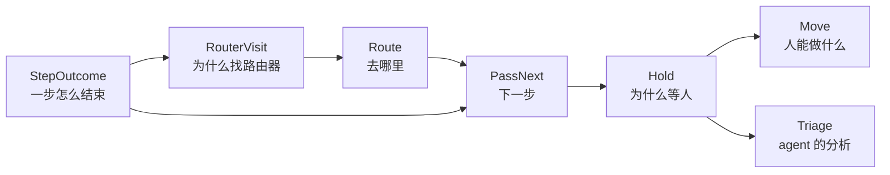

# Lingtai 的类型：一张票从"一步结束"到"等人处理"

> 草稿，待 review。权威定义仍在 [0118](../decisions/0118-a-hold-explains-itself.md) 和 [0120](../decisions/0120-a-reason-is-a-type.md)，这里用代码讲清楚每个类型为什么存在。代码用 TypeScript 写成判别联合（`_tag`），实现时用 zod 定义在 `@lingtai/domain`。

## 原则

1. **原因是类型，不是字符串。** 代码只要按某个值分支，那个值就该是一个变体。
2. **证据跟着变体走。** `BuildRed` 带红的输出，`MergeConflict` 带冲突路径。不存在"某个字段只在某种情况下有值"。
3. **存事实，派生类别。** 类别（"要人拍板"还是"机器坏了"）由函数从事实算出来，不另外存。
4. **一个名字只表示一件事。** 看到变体名就知道它属于哪一层、说的是什么。不单独用 Held、Failure、Continue 这类通用词。
5. **决策是纯函数，副作用在外层。** 纯函数不读数据库、时钟、git 或进程；外层调用纯函数，再按结果行动。

## 一张票的流程



---

## 1. `StepOutcome`：一步怎么结束

**目的**：pass 跑完一步，要知道接下来是继续、找路由器，还是停下。

```ts
type StepOutcome =
  | { _tag: 'Passed' }
  | { _tag: 'ChecksRefused'; evidence: Evidence } // build 红了、review 拒绝了
  | { _tag: 'AgentCommitted'; sha: string } // implement：agent 提交了改动
  | { _tag: 'AgentChangedNothing'; said: string | null } // implement：agent 跑完了，但没提交
  | { _tag: 'AgentAsked'; question: string } // design 或 implement 里 agent 提问
  | { _tag: 'AwaitingSignoff'; question: string } // human: 或 watch: 要人签字放行
  | { _tag: 'RunEndedEarly'; kind: 'crash' | 'timeout' | 'out-of-turns' | 'out-of-usd'; detail: string }
  | { _tag: 'NeverStarted'; why: string } // 账号额度、环境不满足
```

**例子**：#500 第二轮修复，agent 读完 reviewer 的意见，认为要求不对，没有提交就结束了，结果是 `AgentChangedNothing{said: "ticket 写明只支持 ISO"}`。

**审视：合并。** 现在有两个类型描述同一件事：conductor 的 `StepEnding`，以及 0120 草稿里的 `FixOutcome`。"agent 跑完但没提交"在第一次派发时记成 `RunFailed{kind: 'no-commits'}`，在修复轮次里记成 `FixApplied{headSha: null, failure: null}`，两种写法表达同一个事实。所以并成一个 `StepOutcome`，修复轮次就是 implement 这一步又跑了一次，不需要单独的 `FixOutcome`。

---

## 2. `RouterVisit`：为什么找路由器

**目的**：路由器要根据"从哪一步来、为什么来"决定给哪些选项。同样是红，发生在 prepared 和发生在 build，可选的去向不一样；`InputNeeded` 要回到发问的那一步。

```ts
type ArrivalReason =
  | { _tag: 'BuildRed'; output: string }
  | { _tag: 'VerifyRed'; output: string }
  | { _tag: 'ReviewFindings'; findings: Finding[] } // 至少一条有失败场景
  | { _tag: 'ReviewEmpty'; said: string } // reviewer 拒绝了，但没有可执行的意见
  | { _tag: 'ReviewUnreadable'; raw: string } // 回答解析失败，是机器弄丢了
  | { _tag: 'MergeConflict'; paths: string[]; baseSha: string; headSha: string }
  | { _tag: 'InputNeeded'; question: string }

type RouterVisit = { from: Step; reason: ArrivalReason }

const routerVisitOf: (step: Step, outcome: StepOutcome, results: StepResults) => Option<RouterVisit>
```

**例子**：build 跑 `pnpm test`，2 个测试失败，得到 `RouterVisit{from: 'build', reason: BuildRed{output}}`。

**审视：保留，补一个变体。** `ReviewEmpty` 和 `ReviewUnreadable` 必须分开（`pass-steps.ts:885`）：前者是"reviewer 没话说"，后者是"机器把回答弄丢了"，人面对两者的处理不同。现在代码里 `ReviewEmpty` 混在 `findings` 里，用"没有一条带失败场景"来判断，这正是原则 1 说的"按值分支"。

`routerVisitOf` 读的是 conductor 和 actions 的类型，所以它放在 conductor 的纯模块里，也是唯一把步骤结果翻译成 `RouterVisit` 的地方。

---

## 3. `Route`：路由器决定去哪里

**目的**：路由器的决定本身，以及这个决定是怎么来的。日志要分清"judge 选择交给人"和"judge 想再修一轮，被上限拦下"。

```ts
type RouteOffer = { reachable: Step[]; affordable: Step[] } // judge 只能看到 affordable

type Route =
  | { _tag: 'GoToStep'; to: Step } // 回 implement 修，或往前去 merge
  | { _tag: 'RestartFromBase' } // 从 base 重新开始一个 pass
  | { _tag: 'HandToPerson' }

type RouteBasis =
  | { _tag: 'JudgeChose' }
  | { _tag: 'CeilingOverrode'; wanted: Step; ceiling: 'rounds' | 'restarts' | 'usd' }
  | { _tag: 'ReplyRejected'; wanted: string } // judge 回答了一个不在选项里的去向

const offerFor: (visit: RouterVisit, policy: RoutingPolicy) => RouteOffer
const decideRoute: (visit: RouterVisit, offer: RouteOffer, reply: JudgeReply) => { route: Route; basis: RouteBasis }
```

**例子**：reviewer 提了 major，judge 想回 implement 再修，但 3 轮已经用完，结果是 `{route: HandToPerson, basis: CeilingOverrode{wanted: 'implement', ceiling: 'rounds'}}`，存成事件 `PassRouted`。

**审视：保留。** `RouteOffer` 已经存在（`pass.ts:837`）。`Destination` 现在定义了三遍，统一成 `Route` 一处。`RouteBasis` 替代 `PassRouted` 里 `chose` 和 `to` 两个字段的比较，以及那个可空的 `ceiling` 字段。

`JudgeReply` 的来源：内置规则是纯函数；agent 是副作用（要花钱）；没有声明 judge 时，由外层合成一个结果为 `HandToPerson` 的回答。人不是 judge，人是 `HandToPerson` 的去向。

---

## 4. `PassNext`：下一步

**目的**：把"往哪走"和"一步怎么结束"统一成 pass 的下一个动作。只有这里能产生 hold。

```ts
type PassNext =
  | { _tag: 'GoToStep'; to: Step } // 与 Route 共用同一个定义
  | { _tag: 'RestartFromBase' } // 同上
  | { _tag: 'PutOnHold'; hold: Hold }

type RunContext = { run: RunRef; step: Step; visit: RouterVisit | null; spent: Spent }

const nextOf: (input: Route | StepOutcome, ctx: RunContext) => PassNext
```

**例子**：`Route.HandToPerson` 加上 `ctx.visit = {from: 'build', reason: BuildRed}`，得到 `PutOnHold{hold: RouterEscalated{visit, why}}`。

**审视：保留，替代 0120 草稿里的 `transitionOf`。** 原来的结果 `Continue | Restart | Held` 和 `Route` 重复定义了 Continue，现在共用。分类规则（"谁把票交给人"）只写在 `nextOf` 里，由它的穷举测试固定下来。

---

## 5. `Hold`：为什么等人

**目的**：卡片、允许的处理、默认推荐、要不要跑 triage，全都由它决定。

```ts
type Hold =
  // 要人拍板
  | { _tag: 'OwnQuestion'; question: string; by: string } // 人自己用 lingtai ask 提的
  | { _tag: 'AgentQuestion'; run: RunRef; step: Step; question: string }
  | { _tag: 'SignoffRequired'; run: RunRef; step: Step; source: 'declared' | 'injected'; question: string }
  | { _tag: 'FixerDisagrees'; run: RunRef; step: Step; said: string | null }
  | { _tag: 'RouterEscalated'; run: RunRef; visit: RouterVisit; why: string }
  // 机器出了问题，没有人做过判断
  | {
      _tag: 'MergeRefused'
      run: RunRef
      reason: RefusalReason
      paths: string[] | null
      baseSha: string | null
      headSha: string | null
      afterApproval: boolean
      raw: string | null
    }
  | {
      _tag: 'BudgetExhausted'
      run: RunRef
      kind: 'out-of-turns' | 'out-of-usd'
      turns: number | null
      costUsd: number | null
    }
  | { _tag: 'AgentCrashed'; run: RunRef; step: Step; kind: 'crash' | 'timeout'; detail: string }
  | { _tag: 'SetupRefused'; run: RunRef; step: Step; lifts: 'by-itself' | 'person'; why: string }

const holdKind: (hold: Hold) => 'decision' | 'fault' // 派生，不存
```

**例子**：

- 测试修了 3 轮还是红的：`RouterEscalated{visit: {from: 'build', reason: BuildRed}}`
- agent 撞到 250 轮上限：`BudgetExhausted{kind: 'out-of-turns', turns: 251}`
- 有人批准了合并，合并仍然冲突：`MergeRefused{reason: 'conflict', afterApproval: true}`

**审视：三处调整。**

1. **拍平成一层。** 现在是 `Hold = Question | Judgement(…) | Failure(…)` 两层嵌套。没有代码按中间那一层分支：`allowedMoves`、`triageRuns` 都按叶子变体判断。中间层只用于卡片上的文案，按原则 3 改为由 `holdKind` 派生。拍平后 zod 也简单，不用嵌套判别联合。
2. **删掉 `CheckRed`。** 按方案 B，build 红了、轮次用完归 `RouterEscalated{BuildRed}`；合并时的检查红了归 `MergeRefused{reason: 'verify-failed'}`。剩下没有地方会产生它，由 #452 确认后删除。
3. **`DidNotFinish` 拆开。** 现在一个变体装了崩溃和撞上限两种情况。两者的处理不同：崩溃一般重跑，撞上限要先把票拆小。所以撞上限归 `BudgetExhausted`，崩溃归 `AgentCrashed`，"选择不改"归 `FixerDisagrees`。

---

## 6. `Move`：人能做什么

**目的**：卡片上的按钮。由 `allowedMoves(hold)` 决定有哪些，`recommendedMove` 决定先推荐哪个。

```ts
type Move =
  | { _tag: 'Approve' } // 合进 main
  | { _tag: 'Requeue' } // 从 base 重新做
  | { _tag: 'EditBodyAndRequeue' } // 先改正文，再重新做
  | { _tag: 'Answer'; choice: string }
  | { _tag: 'Close' }

const allowedMoves: (hold: Hold) => Move[]
const recommendedMove: (hold: Hold, triage: TriageStatus) => Move | null
```

**例子**：`FixerDisagrees` 允许 `[Approve, Requeue, EditBodyAndRequeue, Close]`。Approve 表示站 fix agent 这边，EditBodyAndRequeue 表示站 reviewer 这边。

**审视：保留**，只把 `BodyAndRequeue` 改名为 `EditBodyAndRequeue`，让名字说清先做什么。

---

## 7. Triage：agent 对 hold 的分析

**目的**：花钱请 agent 读 hold，指出根本原因，推荐一个处理。它只给建议，不会移动票。

```ts
type RootCause =
  | { _tag: 'UndecidedQuestion'; questions: Question[] } // 票里有没定的问题
  | { _tag: 'FixableLines'; fixes: LineFix[] } // 改几行就好
  | { _tag: 'WrongApproach' } // 思路错了，要重来
  | { _tag: 'ConflictingHunks'; hunks: Hunk[]; total: number }
  | { _tag: 'TicketTooBig' } // 要拆票
  | { _tag: 'SetupBroken' }

type TriageResult =
  { _tag: 'TriageFailed'; why: string } | { _tag: 'TriageAdvised'; cause: RootCause; move: Move; summary: string }

type TriageStatus =
  // 读取时推导，不存
  | { _tag: 'NotDeclared' }
  | { _tag: 'Queued' }
  | { _tag: 'Running' }
  | { _tag: 'Interrupted' }
  | { _tag: 'Done'; result: TriageResult }

const triageRuns: (hold: Hold) => boolean
```

**例子**：`MergeRefused{reason: 'conflict'}` 有 3 个冲突块，triage 返回 `TriageAdvised{cause: ConflictingHunks{hunks, total: 3}, move: Requeue}`。

**审视：保留，只改名。** `Cause` 的变体现在叫 `Decision`、`Lines`、`Narrower`，单独看不出意思，按原则 4 改成上面的名字。

---

## 第一性审视：结论

| 类型                                   | 结论                                                             | 理由                                                    |
| -------------------------------------- | ---------------------------------------------------------------- | ------------------------------------------------------- |
| `StepEnding` + `FixOutcome`            | **合并**为 `StepOutcome`                                         | 修复轮次就是 implement 再跑一次；"没提交"现在有两种写法 |
| `Arrival` / `Arrived`                  | 保留，改名为 `ArrivalReason` / `RouterVisit`，并加 `ReviewEmpty` | 路由需要知道来源；"没话说"和"弄丢了"要分开              |
| `Route` + `RouteDecision`              | 保留，改名为 `Route` / `RouteBasis`                              | 日志要分清是 judge 的选择，还是被上限拦下               |
| `transitionOf` 的结果                  | **替换**为 `PassNext`                                            | 和 `Route` 共用 `GoToStep`、`RestartFromBase`           |
| `Hold` 的中间层                        | **删除**，由 `holdKind` 派生                                     | 没有代码按中间层分支                                    |
| `CheckRed`                             | **删除**（等 #452 确认）                                         | 方案 B 之后没有地方会产生它                             |
| `DidNotFinish`                         | **拆开**为 `AgentCrashed` / `BudgetExhausted` / `FixerDisagrees` | 三种情况，三种不同的处理                                |
| `Move`、`TriageResult`、`TriageStatus` | 保留                                                             | 已经是该有的形状                                        |
| `Cause`                                | 保留，改名为 `RootCause`，变体也改名                             | 现在的名字单独看不出意思                                |

## 待你决定

1. `StepOutcome` 的合并会改 conductor 内部的 `StepEnding` 和事件 `FixApplied`，属于 0120 第二期。同意合并吗？
2. `Hold` 拍平后，`_tag` 会写进日志（`WorkItemBlocked`），同样要等第二期的日志重置。拍平和改名一起做，还是先做拍平？
3. `holdKind` 只分 `decision` 和 `fault` 两类，`OwnQuestion` 也算 `decision`。还是要单独列一类 `question`？
