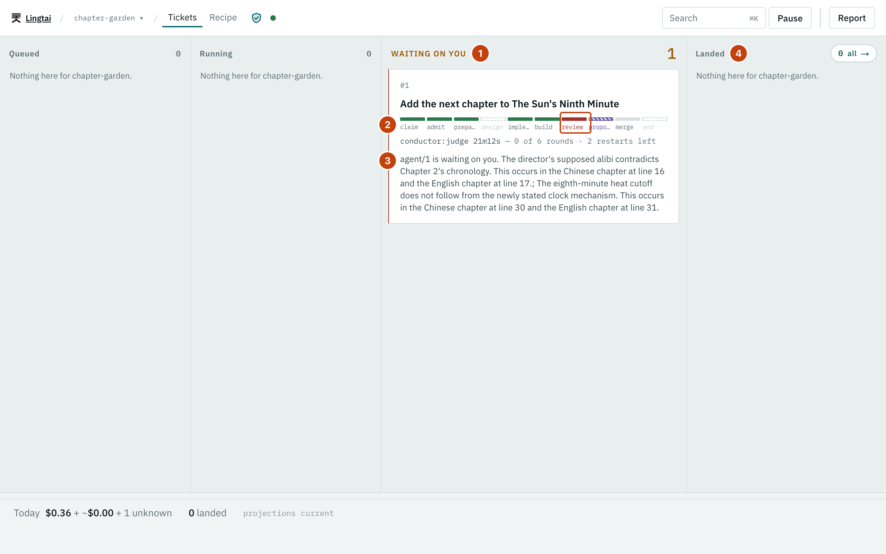
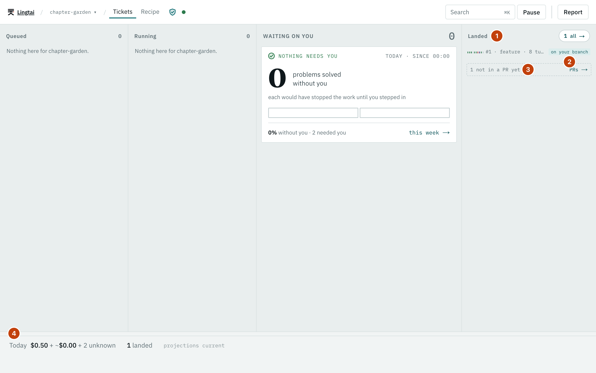

# Tutorial

*Tutorial — get one ticket to land*

Try Lingtai on [Chapter Garden](https://github.com/steven-zhc/chapter-garden),
an Astro site: set up, open a ticket, let an agent work.

## Before you start

You need Git, Claude Code or Codex signed in, and Node.js 26.13.0 with npm. See
[requirements](requirements.md).

## Step 1 — Set up this machine

Install, clone, register. Press Enter at each question.

```sh
curl -fsSL https://lingtai.hczhang.com/install.sh | sh
git clone https://github.com/steven-zhc/chapter-garden.git
lingtai init --local chapter-garden
```

With the sandbox on, `init` runs `claude setup-token` once, opening a browser.
Skip it and the first ticket fails until `lingtai token claude`; see
[requirements](requirements.md#tokens-for-a-sandboxed-run).

If `lingtai` is not found, add `~/.local/bin` to `PATH`.

`init` picks from what is signed in:

| Signed in | Writes | Reviews |
|---|---|---|
| Claude Code only | Claude Code | Claude Code |
| Codex only | Codex | Codex |
| Both | Claude Code | Codex |

Another vendor's reviewer catches more; one suffices.

Enter at the mode question makes a **team** project; [`solo`](solo.md) is the other.


[Open the diagram at full size](img/team-flow.svg).

## Step 2 — Open one ticket

Pick a story from the [bookshelf](https://cg.hczhang.com/en/). Run once; a second
run is a second paid ticket.

```sh
lingtai ticket new --title "Add the next chapter to The Sun's Ninth Minute" --label feature \
  --body "Find the latest chapter of this story and write one new chapter that continues it. Follow the story's existing language, chapter numbering, and Markdown layout. Keep earlier chapters unchanged. Done when the new chapter appears on the site."
```

Continue when Lingtai prints `created #N`.

## Step 3 — Start

Starting pays for at least two runs, writer and reviewer, on the accounts above,
more if a check buys a fix round.

```sh
lingtai start
```

Leave it running; `Ctrl+C` stops after the attempt in flight. In a second
terminal run `lingtai board`: no login, every address; `board.host: 127.0.0.1`
in `~/.lingtai/config.yml` keeps it local.

If review raises findings, the card stops in **Waiting on you**:



1. **Waiting on you**: nothing more is spent until you answer.
2. **review** is red: built, then refused.
3. The findings. On the card's page: another writer round, a new attempt, or approve.
4. **Landed** is empty until review passes or you approve.

When the card is **Landed**:



1. **Landed**: merged into your branch.
2. **on your branch**: not yet on `main`.
3. **1 not in a PR yet**: waits for your PR.
4. Today's spend.

Look at what landed:

```sh
git -C chapter-garden log -1 --stat lingtai-base
git -C chapter-garden diff main...lingtai-base
```

The next chapter takes it to `main` in a PR. To OK each landing first, declare
a `human:` at `proposed:`; see [the recipe](recipe.md).

## Next

Next: [Team mode](team.md) — the way we recommend working.
